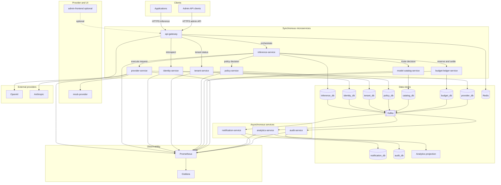
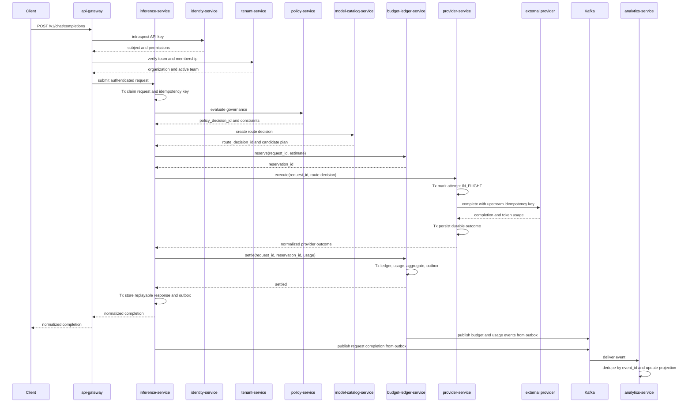
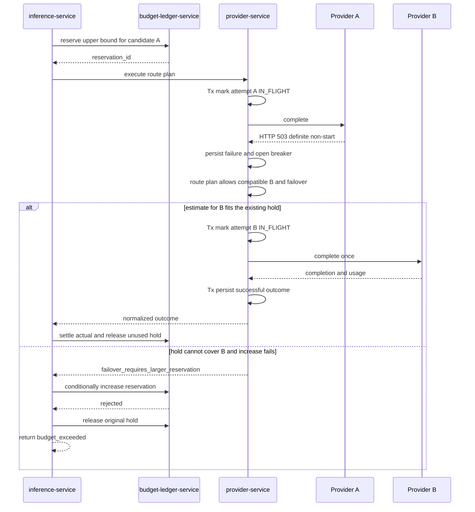
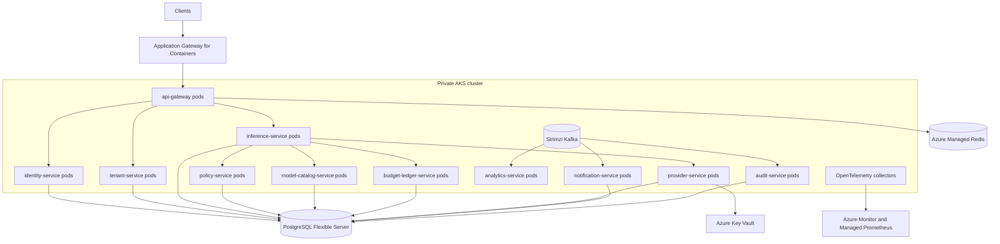
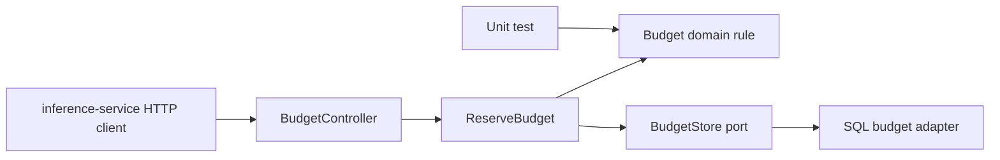
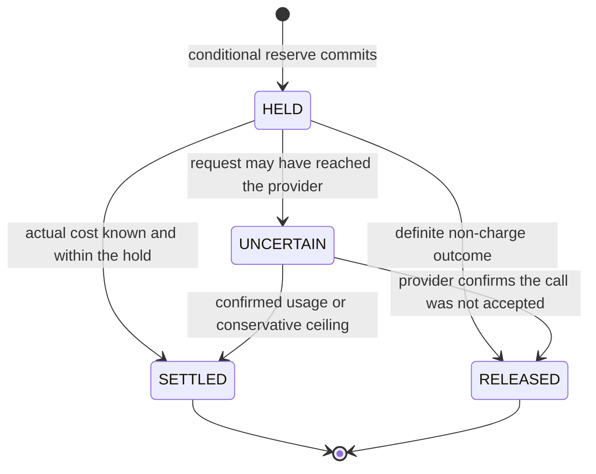
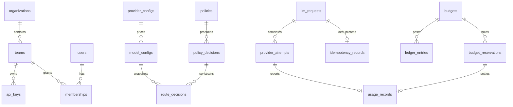

# AI Gateway Platform

The AI Gateway Platform is a centralized infrastructure platform for managing organizational access to external large language model providers such as OpenAI and Anthropic. Applications call one gateway API. The platform authenticates the caller, enforces governance and budgets, routes the request to a provider adapter, records the financial outcome, and publishes usage events for analytics.

This is an infrastructure and distributed-systems project. It does not train or host a language model. The engineering problem is financial correctness, concurrency safety, fault tolerance, and reliable event processing when many requests run at once and external providers fail.

**Status.** This repository currently contains the technical specification and implementation roadmap for an 11-service platform deployed to Azure Kubernetes Service (AKS). Application code, database migrations, Helm charts, Docker Compose files, and tests are introduced by the phases below. Commands in [Local development](#local-development) describe the intended workflow. They have not been executed against an implementation in this repository.

**How to read the labels.**

| Label | Meaning |
| --- | --- |
| **MVP** | Required for the first complete, testable platform. |
| **Planned** | Designed here, scheduled after the MVP dependency it relies on. |
| **Optional** | Useful, but the backend is complete without it. |
| **Future enhancement** | Explicitly out of the initial local-deployment scope. |

## Contents

1. [Motivation](#motivation)
2. [Features](#features)
3. [Technology stack](#technology-stack)
4. [Architecture overview](#architecture-overview)
5. [Azure Kubernetes deployment](#azure-kubernetes-deployment)
6. [Hexagonal architecture](#hexagonal-architecture)
7. [Service and module catalog](#service-and-module-catalog)
8. [Request lifecycle](#request-lifecycle)
9. [Budget reservation and settlement](#budget-reservation-and-settlement)
10. [Resilience and recovery](#resilience-and-recovery)
11. [Database model](#database-model)
12. [API reference](#api-reference)
13. [Event catalog and Kafka flow](#event-catalog-and-kafka-flow)
14. [Security and privacy](#security-and-privacy)
15. [Testing strategy](#testing-strategy)
16. [Repository structure](#repository-structure)
17. [Local development](#local-development)
18. [Implementation roadmap](#implementation-roadmap)
19. [Definition of done](#definition-of-done)
20. [Limitations and future improvements](#limitations-and-future-improvements)

## Motivation

Teams that integrate providers directly tend to accumulate one-off API keys, inconsistent retry behavior, and no shared view of spend. A single application bug can open unbounded concurrent calls. A timeout can hide whether the provider billed the call. Finance then reconciles invoices by hand, long after the budget was exceeded.

The gateway moves those controls to one place:

- One credential and one request contract per application.
- A team budget that is enforced before a paid call starts, including calls that are in flight.
- A ledger that can be reconciled with provider invoices.
- A bounded failure policy so retries and failover do not silently multiply charges or copy prompts to unexpected providers.
- An event stream that analytics and alerts can rebuild from, without becoming a second financial authority.

The authoritative financial state lives in PostgreSQL. Kafka, Redis, the analytics service, and the optional dashboard are downstream or advisory.

## Features

**MVP**

- Unified non-streaming chat-completions API and a model listing.
- Organizations, teams, users, hashed API keys, and role checks.
- Provider and model allowlists, token ceilings, and explicit policy precedence.
- Atomic budget reservation, settlement, release, and an append-only ledger.
- Idempotency for client retries and for financial settlement.
- Mock provider with configurable failure modes.
- Provider adapters for OpenAI, Anthropic, and the mock provider, behind one port.
- Static-priority routing with health filtering, bounded retries, circuit breakers, bulkheads, and opt-in failover.
- Transactional outbox and Kafka publication.
- Python analytics for spend, token usage, a simple forecast, and spike detection.
- Structured logs, Prometheus metrics, health checks, audit log, and webhook alerts.
- Docker Compose environment for PostgreSQL, Redis, Kafka, Prometheus, and Grafana.
- Eleven production microservices with independent images, deployments, databases, and autoscaling policies.
- Helm-based deployment to Azure Kubernetes Service.
- Azure Workload Identity and Key Vault integration for service credentials.

**Planned**

- Price-aware and latency-aware routing strategies.
- Streaming responses.
- Read-only backfill of analytics from a usage snapshot when the event journal is gone.
- Email and Slack notification channels.
- OpenTelemetry trace export as a standard local path.
- Consumer-driven contract tests and backward-compatible rolling upgrades for internal APIs.

**Optional**

- React administrative dashboard.

**Future enhancement**

- Terraform or Bicep automation after the first Helm-based AKS deployment is understood.
- Service mesh; the initial AKS release uses Kubernetes networking, NetworkPolicies, and application-level resilience.
- Multi-region active/active deployment.
- Human login through an external identity provider.

## Technology stack

### Core backend

| Choice | Role |
| --- | --- |
| Java 21+ LTS | Language baseline. Virtual threads carry blocking provider I/O. |
| Spring Boot 3.x on Java 21 | Application runtime. Use the current 3.x train that supports Java 21 unless the repository later standardizes on a newer compatible train. |
| Spring MVC | Synchronous request path. |
| Spring Security | API-key authentication and role checks. |
| Spring Data JPA and Hibernate | Persistence. Financial updates that protect invariants use explicit SQL. |
| PostgreSQL | Authoritative transactional databases, one owned database per service. |
| Flyway | Versioned schema migrations. |
| Bean Validation | Request and configuration constraints. |
| Resilience4j | Circuit breakers, retry, and bulkheads around provider calls. |
| Spring `RestClient` | Blocking HTTP client per provider, with connect and response timeouts. |
| JUnit 5, Mockito, Testcontainers | Unit and integration tests. WireMock for provider-adapter contracts. |

Spring WebFlux is a **future enhancement**. Streaming or a measured bottleneck would justify it, and only at the edge that needs it. The MVP stays on one programming model: Spring MVC plus virtual threads.

### Python services

| Choice | Role |
| --- | --- |
| Python 3.12+ | Language baseline for supporting services. |
| FastAPI and Pydantic v2 | HTTP APIs for analytics and the mock provider. |
| pandas and NumPy | Aggregations, rolling statistics, and trend extrapolation. |
| pytest and HTTPX | Service tests. |
| Kafka client (`confluent-kafka` or `aiokafka`) | Analytics consumption. |

scikit-learn is **optional** and is not an MVP dependency. Python services consume events and serve analytical reads. They do not update team budgets, reservations, or ledger rows.

### Infrastructure

| Component | MVP role |
| --- | --- |
| PostgreSQL | Local containers; Azure Database for PostgreSQL Flexible Server for AKS deployments. |
| Redis | Local container; Azure Managed Redis for AKS rate limits and short-lived counters. |
| Apache Kafka | Local container; Strimzi-managed Kafka on AKS for the initial Azure deployment. |
| Docker Compose | Local runtime only. |
| AKS and Helm | Production-like runtime and release packaging. |
| Azure Container Registry | Versioned OCI images. |
| Azure Key Vault and Workload Identity | Secret delivery without long-lived Azure credentials in pods. |
| Azure Managed Prometheus and Azure Managed Grafana | AKS metrics and dashboards. |
| OpenTelemetry | Instrumentation API in the gateway. A collector is added with the observability phase. |
| GitHub Actions | Unit tests on every push; integration tests that need Docker run in CI when the runner provides a Docker daemon. |

AKS is a required deployment target but not part of the inner development loop. Docker Compose remains the local runtime. Terraform/Bicep and a service mesh are not prerequisites for the first AKS release.

### Frontend

An administrative UI is an **optional** React and TypeScript application. Every management and inference operation must be possible through the HTTP API before the UI exists. The UI is a client of the API, not a second place where budgets are edited directly.

## Architecture overview

### Microservice boundaries

This project deliberately uses microservices. A service is not just a package with a different name: every service below has its own executable, API, release artifact, health endpoint, migrations, database ownership, and failure boundary. Services communicate through versioned HTTP contracts on the synchronous path and Kafka events on asynchronous paths.

A **logical module** is still useful inside a service. For example, reservation and ledger are modules inside `budget-ledger-service` because they share one financial invariant and must commit atomically. A logical module is not independently deployed and cannot access another service's database.

| Service | Stack | Owns | Must not own |
| --- | --- | --- | --- |
| `api-gateway` | Java, Spring Boot | Public ingress, request limits, rate limiting, authentication facade, response/error normalization | Workflow, identity, policy, financial, or provider persistence |
| `inference-service` | Java, Spring Boot | Durable inference saga, client idempotency, normalized request/response state | Identity rows, policies, provider credentials, budgets, ledger |
| `identity-service` | Java, Spring Boot | Users, service identities, API-key hashes, roles, key expiration and revocation | Organization/team lifecycle or budgets |
| `tenant-service` | Java, Spring Boot | Organizations, teams, memberships, tenant status and currency | Credentials, policies, or financial state |
| `policy-service` | Java, Spring Boot | Organization defaults, team overrides, allowlists, token ceilings, privacy and failover rules | Models, prices, provider credentials, or balances |
| `model-catalog-service` | Java, Spring Boot | Model aliases, provider metadata without secrets, capabilities, pricing versions, immutable route decisions | Credentials, breakers, or balances |
| `budget-ledger-service` | Java, Spring Boot | Budget periods, reservations, usage facts, settlement, append-only ledger, financial reconciliation | Provider invocation or analytical projections |
| `provider-service` | Java, Spring Boot | Provider credentials, adapters, durable provider attempts, retries, breakers, failover execution, uncertain outcomes | Team budget or policy administration |
| `notification-service` | Java, Spring Boot | Alert deduplication and delivery status | Budget enforcement |
| `analytics-service` | Python, FastAPI | Kafka projections, forecasting, anomaly hints | Authoritative financial writes |
| `audit-service` | Java, Spring Boot | Immutable central projection and query API for administrative audit events | Synchronous authorization or mutation of source aggregates |
| `mock-provider` | Python, FastAPI | Deterministic provider simulation and chaos modes | Platform business data |
| `admin-frontend` | React, TypeScript | **Optional** UI | Direct database access |

The first eleven rows are production microservices. `mock-provider` is a development/test service and does not count toward the eleven. This split follows bounded contexts rather than one service per table. Reservation, settlement, usage, and ledger remain together because separating them would require distributed transactions to protect money. Policy decides what is allowed; model catalog decides how an allowed alias maps to versioned candidates and prices. The final route decision records both inputs.

Each service owns a separate PostgreSQL **database** in deployed environments. Docker Compose may run those databases on one PostgreSQL server to reduce local resource use, but each database has a distinct user and no service receives credentials for another database. Cross-database joins, shared JPA entities, and direct reads of another service's tables are prohibited.

`api-gateway` is a stateless public edge. `inference-service` is the orchestrator, but not a financial authority. The request path is a persistent saga:

1. Authenticate the credential through `identity-service` and verify active tenant/membership through `tenant-service`.
2. Claim the client idempotency key in the inference database.
3. Obtain an effective governance decision from `policy-service`.
4. Obtain a versioned route decision from `model-catalog-service`.
5. Reserve through an idempotent command to `budget-ledger-service`.
6. Execute through an idempotent command to `provider-service`.
7. Settle or release through `budget-ledger-service`.
8. Store the normalized response in the inference database.

Every command uses the same `request_id`. A retry reads existing state and resumes the saga; it does not start a second logical request. There is no distributed ACID transaction across these steps.

### Deployment topology

```text
Clients
  -> api-gateway
       -> identity-service
       -> tenant-service
       -> inference-service
            -> policy-service
            -> model-catalog-service
            -> budget-ledger-service
            -> provider-service -> OpenAI | Anthropic | mock-provider
       -> analytics-service (read facade)
       -> audit-service (read facade)
       -> Redis (rate limits and short-lived caches)
  each service -> its own PostgreSQL database and transactional outbox
  each outbox publisher -> Kafka
  Kafka -> analytics-service -> analytics projection
  Kafka -> notification-service
  -> Prometheus -> Grafana
```

The provider HTTP call, service-local PostgreSQL transactions, and Kafka publication are separate steps. They are not one distributed ACID transaction. A service's database commit is authoritative for the aggregate that service owns. Kafka and other services catch up afterward.

### Cross-cutting conventions

**Money.** Authoritative amounts are integers in micro-units of the organization's currency. One currency unit equals `1_000_000` micro-units. USD $0.25 is `250_000`. PostgreSQL stores these as `BIGINT`. Java uses `long` inside a `Money` value type. The MVP supports one currency per organization, recorded on the organization row. Binary floating-point types (`float`, `double`, PostgreSQL `REAL`/`DOUBLE PRECISION`) are not used for budgets, prices, estimates, or ledger amounts.

**Rounding.** Reservation estimates and internal charges round **up** to the next micro-unit. That biases the team budget slightly high relative to a fractional provider price and avoids under-reserving because of truncation. Invoice differences are corrected with explicit ledger adjustments.

**Time.** All timestamps are `timestamptz`, stored in UTC, and serialized as ISO-8601 with an offset. Budget periods use an inclusive `period_start` and an exclusive `period_end`. A request keeps the budget row it reserved against even if the wall clock crosses into the next period before settlement.

**Identifiers.** Public request, reservation, and event ids are UUID v4 (`java.util.UUID`). Ledger and outbox rows also have a `BIGSERIAL` surrogate so publishers and auditors can order rows created in one database. Client idempotency keys are opaque strings supplied by the caller, unique per team, with a maximum length of 255.

**Correlation.** The gateway accepts `X-Request-Id` when it is a safe token, otherwise it generates one. That id is the `llm_requests.id` exposed to the client, the trace attribute, and the log field `request_id`. Internal retries of the same provider call reuse one upstream idempotency key derived from the request id: `gw-{requestId}`.

### Consistency boundaries

| Step | Consistency boundary |
| --- | --- |
| Authenticate key and tenant | Identity-service verifies the credential; tenant-service verifies organization, team, and membership status. Positive results may be cached for at most 60 seconds, making revocation delay explicit. |
| Claim request and idempotency key | One inference-database transaction. |
| Evaluate governance | One policy-service request returning immutable `policy_decision_id`. |
| Select route | One model-catalog-service request returning `route_decision_id`, price version, candidate list, and maximum estimate bound to the policy decision. |
| Reserve | One budget-database transaction. Idempotent on `request_id`. |
| Mark provider call started | One provider-database transaction committed **before** the external socket write. |
| Provider HTTP call | Outside every database transaction and bounded by the request deadline. |
| Persist provider outcome | One provider-database transaction. The gateway can retrieve it after a crash. |
| Settle or release | One budget-database transaction containing reservation, usage, ledger, and budget outbox changes. |
| Complete client request | One inference-database transaction storing the replayable response and inference outbox event. |
| Publish and consume events | After local commits; delivery is at-least-once and projections are eventual. |

Redis unavailability does not bypass the budget check. Rate limiting degrades to a per-process bulkhead. The PostgreSQL budget remains the hard control.

### Architecture diagram



### Successful request



### Provider failure, circuit breaker, and failover

This sequence is the **definite failure** path: the provider returned an error that means generation did not start and no charge was accepted. A timeout after the request bytes were sent does not use this path. That case is [uncertain reservation handling](#uncertain-reservations-and-reconciliation).



While the breaker for A is open, `provider-service` skips A and starts at the next candidate already authorized by the immutable route plan. A half-open probe is a single trial call, not a failover fan-out.

## Azure Kubernetes deployment

AKS is the required production-like deployment target. Only stateless application processes and Kafka run as pods. PostgreSQL, Redis, image storage, secrets, and managed observability use Azure services so the cluster is not responsible for every stateful concern.

### Azure resource topology

| Azure resource | Purpose |
| --- | --- |
| AKS private cluster | Runs the eleven production services, Strimzi operator/Kafka, and OpenTelemetry collectors. |
| Azure Container Registry (ACR) | Stores one independently versioned image per service. AKS pulls through managed identity. |
| Application Gateway for Containers | Public HTTPS ingress to `api-gateway` only. Internal services use `ClusterIP` Services. |
| Azure Database for PostgreSQL Flexible Server | Hosts one logical database and least-privilege role per state-owning service, reachable through a private endpoint. |
| Azure Managed Redis | Shared infrastructure for rate limits and disposable caches. Key prefixes and ACLs isolate service usage. |
| Azure Key Vault | Provider credentials, database passwords where Entra authentication is unavailable, webhook secrets, and signing keys. |
| Azure Workload Identity | Maps a Kubernetes ServiceAccount to a user-assigned managed identity without storing Azure client secrets. |
| Azure Managed Prometheus and Grafana | Scrapes pod metrics and hosts operational dashboards. |
| Log Analytics and Application Insights | Receives container logs and OpenTelemetry traces. |

Strimzi Kafka runs on a dedicated AKS user node pool with zone-aware replicas and Azure managed disks. This demonstrates Apache Kafka operations but carries real operational cost. A later production decision may replace it with a managed Kafka offering after contract and semantic compatibility tests; Azure Event Hubs' Kafka endpoint is not assumed to be a drop-in replacement.



### Kubernetes packaging

- One Helm chart per service defines `Deployment`, `Service`, `ServiceAccount`, `ConfigMap`, `PodDisruptionBudget`, `HorizontalPodAutoscaler`, and `NetworkPolicy`.
- An umbrella chart pins service chart versions for an environment but does not force every image to share one version.
- Every production service has at least two replicas except singleton migration Jobs and components whose partition ownership makes one replica intentional during the MVP.
- Pods define CPU/memory requests and limits, startup/readiness/liveness probes, topology spread constraints, and graceful termination long enough to stop accepting requests and finish or persist in-flight work.
- Readiness checks local dependencies required to serve the next request. They do not recursively fail because an optional downstream service or Kafka is unavailable.
- Flyway runs as a pre-deployment Kubernetes Job for the owning service. Application pods use a database role that cannot perform arbitrary schema migrations.
- `api-gateway` is the only application service with public ingress. Default-deny NetworkPolicies permit only documented service-to-service edges.
- Pod-to-pod calls use Kubernetes DNS and short deadlines. Service discovery does not require a service mesh.

### AKS identity and secrets

Each service has a dedicated Kubernetes ServiceAccount and, only when Azure access is needed, a dedicated user-assigned managed identity. Federated identity credentials bind the two. Key Vault secrets are read through the Secrets Store CSI Driver or Key Vault SDK; they are not committed to Helm values, Kubernetes manifests, container images, or GitHub variables as plaintext.

`provider-service` alone can read provider API credentials. CI can push to ACR and deploy Helm releases through GitHub Actions OIDC federation; it has no provider-secret read permission. Database network access is private, and each service still receives credentials for only its database.

### Scaling and availability

| Workload | Scaling signal | Constraint |
| --- | --- | --- |
| `api-gateway` | CPU, request rate | Stateless; minimum two replicas. |
| `inference-service` | CPU and active saga count | Recovery uses durable workflow state; replicas need no sticky sessions. |
| Identity, tenant, policy, catalog | CPU and request latency | Cache only disposable reads; minimum two replicas. |
| `budget-ledger-service` | CPU, DB connection saturation, reserve latency | Database remains serialization point; scaling pods does not bypass row locks. |
| `provider-service` | Active calls per provider and CPU | Per-pod breakers are not globally coordinated; bulkhead capacity must account for replica count. |
| Kafka consumers | Kafka lag through KEDA | Replica count cannot usefully exceed relevant partition count. |

The initial cluster uses a system node pool, a general application node pool, and a dedicated Kafka node pool. Production and staging should use separate clusters or, at minimum, separate PostgreSQL servers and strict namespaces; namespaces alone are not a strong security boundary. Availability zones, PodDisruptionBudgets, and topology spread reduce correlated failures but do not create a multi-region guarantee.

### Delivery pipeline

1. Pull request: unit, integration, architecture-boundary, contract, container, and Helm lint tests.
2. Main branch: build changed service images, generate an immutable version, scan, and push to ACR.
3. Deploy to staging with `helm upgrade --install --atomic --wait`.
4. Run smoke, saga-recovery, and migration compatibility tests.
5. Promote the exact image digests and chart versions to production after approval.
6. Roll back the Helm release only when the database migration is backward compatible. Destructive migrations require expand-and-contract across releases.

AKS provisioning can initially be documented with repeatable Azure CLI commands. Terraform or Bicep becomes mandatory before environments are recreated regularly; manual portal configuration is not an acceptable long-term source of truth.

## Hexagonal architecture

Hexagonal architecture is applied independently inside each Java microservice where a boundary protects either a domain rule or an external system. Services do not share domain modules or JPA entities. They may share generated API clients, event schemas, and observability libraries, but those artifacts contain no business logic.

| Ring | Contents | Depends on |
| --- | --- | --- |
| Domain | The service's own rules: budget arithmetic in `budget-ledger-service`, route plans in `model-catalog-service`, provider attempt states in `provider-service`. | Nothing Spring-specific and no code from another service. |
| Application | Service-local use cases such as `ReserveBudget`, `SettleReservation`, `DecideRoute`, or `ExecuteProviderCall`. | Domain and outbound ports. |
| Inbound adapters | REST controllers, scheduled recovery, Kafka consumers. | Application use cases. |
| Outbound ports | Service-local repositories, HTTP clients for explicitly allowed dependencies, `Clock`, and `EventOutbox`. | Domain types only. |
| Outbound adapters | JPA/SQL, generated HTTP clients, provider adapters, Kafka publisher, Micrometer. | Ports and frameworks. |

Dependency inversion matters at three boundaries:

- **Budget persistence**, so the invariant can be unit-tested without PostgreSQL, while the SQL that enforces the invariant is tested with Testcontainers.
- **Provider calls**, so `provider-service` can test execution and recovery with a fake adapter.
- **Clock**, so reservation deadlines are deterministic in tests.

Dependency inversion is unnecessary ceremony for simple CRUD inside a service. `tenant-service` may use Spring Data repositories directly for organizations and memberships. A service boundary itself is not an excuse to create an interface for every class.



The domain rule answers whether a single budget snapshot can accept a hold. Concurrency safety is the SQL adapter's job, not the pure function's job. Tests cover both layers.

```java
final class Budget {
    private final long limitAmount;
    private final long settledSpend;
    private final long reservedAmount;

    boolean canReserve(long estimate) {
        if (estimate <= 0) {
            return false;
        }
        return settledSpend + reservedAmount + estimate <= limitAmount;
    }
}
```

A unit test builds `Budget` values and checks `canReserve`. An integration test runs two transactions against PostgreSQL and checks that only one conditional `UPDATE` wins. Neither test calls OpenAI.

## Service and module catalog

Each Java service uses its own package root under `dev.aigateway`. Feature packages inside that service own domain, application, and adapter code. No service imports another service's implementation package.

```text
dev.aigateway.gateway             # public edge only
dev.aigateway.inference           # durable inference saga
dev.aigateway.identity            # identity-service only
dev.aigateway.tenant              # tenant-service only
dev.aigateway.policy              # policy-service only
dev.aigateway.modelcatalog        # model-catalog-service only
dev.aigateway.budgetledger        # budget-ledger-service only
dev.aigateway.provider            # provider-service only
dev.aigateway.notification        # notification-service only
dev.aigateway.audit               # audit-service only
```

Every service contains its own `domain`, `application`, `adapter.in`, and `adapter.out` packages only where those layers add value.

### API gateway

**Service:** `api-gateway`  
**Owns:** public HTTP contract, authentication facade, request-size limits, Redis rate limiting, correlation ids, ingress authorization, and public error normalization.  
**Depends on:** identity and tenant services for authentication, inference-service for inference, and owning services for administrative/read facades.  
**Does not own:** workflow persistence, pricing, provider invocation, or reservation SQL.

**MVP behavior**

- Accept `POST /v1/chat/completions` for non-streaming chat.
- Accept `GET /v1/models` for aliases the caller is allowed to use.
- Require `Authorization: Bearer`.
- Reject bodies above the configured limit (default 1 MiB) with `413`.
- Apply an end-to-end deadline (default 35 seconds) propagated to every downstream call.
- Return a normalized completion: `id`, `object`, `model` (the alias), `choices`, `usage`, plus `X-Request-Id` and `X-Reservation-Id`.

The chat contract follows the common OpenAI-style shape for `model`, `messages`, `temperature`, and `max_tokens`. That is a practical subset for chat completions. It is not a claim of full OpenAI API compatibility, and it is not a claim that Anthropic's native API is exposed. Provider-specific fields stay inside adapters. `stream: true` is rejected with `400` and `streaming_not_supported` until the streaming phase.

### Inference orchestration

**Service:** `inference-service`  
**Owns:** `llm_requests`, client idempotency, the persistent saga, downstream command sequencing, recovery, and replayable normalized responses.  
**Depends on:** policy, model-catalog, budget-ledger, and provider internal APIs.  
**Does not own:** authentication credentials, configuration tables, provider secrets, or financial balances.

The API gateway submits an already authenticated principal and validated request. `inference-service` rechecks that the service token is valid, claims `(team_id, idempotency_key)`, and resumes existing workflow state after retries or pod restarts.

### Identity and access management

**Service:** `identity-service`  
**Owns:** users, service identities, API keys, roles/scopes, expiration, rotation, and revocation.  
**Depends on:** its own database and key-hashing primitives.  
**Inbound:** internal key-introspection API and administrative REST API through the gateway.  
**Outbound:** its own JPA repositories and outbox.

An API key resolves in this order:

1. Read the bearer token. The format is `sk_` + an 8-character prefix + a secret.
2. Load `api_keys` by the unique prefix.
3. Reject missing, revoked, and expired keys.
4. Hash `pepper || secret` with SHA-256 and compare in constant time to `key_hash`. The pepper comes from `KEY_HASH_PEPPER`.
5. Return subject id, bound team id, key id, and scopes. `tenant-service` separately verifies that the team, organization, and membership are active.

The full secret is returned once, in the create-key response. The database stores `key_prefix` and `key_hash`. SHA-256 is appropriate because the secret is a 256-bit random value, not a human password.

**Roles (MVP),** stored as identity grants referencing tenant ids and as scopes on API keys:

| Role or scope | Can do |
| --- | --- |
| `ORG_ADMIN` | Manage teams, policies, budgets, and keys inside the organization. |
| `TEAM_ADMIN` | Manage keys, policies, and budgets for one team. |
| `TEAM_MEMBER` | Read usage for one team. |
| Scope `inference` | Call `/v1/chat/completions` and `/v1/models`. |
| Scope `usage.read` | Read that team's usage and current budget. |

**MVP authentication** for admin endpoints is a bearer key with an admin role, including a bootstrap admin token supplied by the environment for local setup. Interactive OIDC login is a **future enhancement** tied to the optional dashboard.

**Rotation.** Create a new key, deploy it, then revoke the old key. Revocation sets `revoked_at` and takes effect on the next request. Lookup never resurrects a revoked hash.

Every query that reads tenant data includes the organization or team from the principal. A team id in the URL must match the principal unless the principal is an organization admin for that team's organization.

### Tenant management

**Service:** `tenant-service`  
**Owns:** organizations, teams, memberships, tenant status, and organization currency.  
**Depends on:** its own database. Identity subject ids are external references, not foreign keys.  
**Inbound:** membership/status verification and administrative CRUD through the gateway.  

Identity proves who the caller is; tenant-service proves which active organization/team resources that identity may act on. Membership changes publish versioned events so identity-side authorization caches can be invalidated. Security-sensitive requests still perform a synchronous tenant check.

### Policy and governance

**Service:** `policy-service`  
**Owns:** allowlists and ceilings. One active policy document per scope.  
**Depends on:** organization and team identifiers supplied by the authenticated principal; it reads neither identity nor tenant databases.  
**Does not own:** model aliases, prices, provider credentials, reservations, or balances.

Policy fields:

- Allowed provider ids.
- Allowed model aliases.
- Maximum input characters and maximum `max_tokens`.
- Whether prompt failover to another provider is allowed. Default is `false`.
- Optional per-alias failover allowlist. Candidates must also appear in the provider allowlist.

**Precedence.** The team policy replaces an organization default field when the team field is present. A missing team policy means the organization policy applies in full. A request that names an alias or provider outside the effective allowlist is rejected with `403` and `model_not_allowed` before any reservation. There is no implicit "allow all" in production configuration. Local development seeds an explicit allowlist that includes the mock provider.

### Budget and quota management

**Service:** `budget-ledger-service`  
**Owns:** periods, holds, the budget aggregate, and the financial invariant.  
**Depends on:** PostgreSQL through `BudgetStore`. Redis is not a source of budget truth.  
**Detailed design:** [Budget reservation and settlement](#budget-reservation-and-settlement).

The service exposes idempotent internal commands `reserve`, `increase`, `settle`, `release`, and `reconcile`. Only this service's application layer updates `settled_spend` or `reserved_amount`. `markCallStarted` belongs to `provider-service`.

Request rate limits live beside this module in the API edge. They use a Redis fixed window per API key (default 60 requests per minute, configurable). A rate-limit rejection happens before reservation. If Redis is down, the gateway keeps a conservative in-process limit and still enforces the database budget. Rate limiting is abuse protection. The budget is the financial control.

When the conditional reservation update matches no row, the client receives `402` and `budget_exceeded`. No provider call is made.

### Model routing

**Service:** `model-catalog-service`  
**Owns:** alias resolution and candidate ordering.  
**Depends on:** a signed/versioned policy decision and local `model_configs`. It does not call provider-service or read live breaker state.  
**Does not own:** a learned ranking model. Routing in the MVP is deterministic configuration.

A **model alias** (`team-chat`) is what clients send in `model`. One alias has one or more `model_configs` rows: provider, upstream model name, priority, prices, context window, and capabilities. The MVP capability is `chat`.

**MVP selection**

1. Drop candidates the effective policy does not allow.
2. Drop candidates that lack the required capability or context window.
3. Estimate a conservative upper bound for every remaining candidate.
4. Order candidates by configured priority and encode which failovers are authorized.
5. Persist and return the immutable candidate plan to inference-service.

`provider-service` applies live health and breaker filtering to this already-authorized plan. If every authorized candidate is open, it fails with `provider_unavailable` rather than fan-out probing. A half-open probe is a single trial call to the highest-priority eligible candidate.

**Planned strategies,** selected by a `routing_mode` on the alias:

- `price`: cheapest healthy candidate whose estimate fits.
- `latency`: lowest rolling p95 using provider-health events projected into model-catalog, with stale health explicitly marked. This is an operational statistic, not a machine-learning model.

Failover uses the same filter on the remaining candidates and also requires `allow_prompt_failover`. See [Resilience and recovery](#resilience-and-recovery).

### Provider integration

**Service:** `provider-service`  
**Owns:** the outbound port and adapters.  
**Depends on:** its own `provider_configs` for endpoints, timeouts, feature flags, and secret references. Inference-service passes an immutable route decision created by model-catalog; provider-service reads neither policy nor catalog databases.

Port used by application services:

```java
interface LlmProvider {
    CostEstimate estimateCost(EstimateQuery query);
    ProviderCompletion complete(ProviderCall call);
    ProviderErrorClassification classify(ProviderFailure failure);
}
```

`stream` is omitted until the streaming phase. Each adapter maps provider payloads into `ProviderCompletion` (output text, input tokens, output tokens, provider request id) and into a classification:

| Classification | Examples | Safe to retry or fail over automatically |
| --- | --- | --- |
| `REJECTED` | 400, schema mismatch | No. Release the hold if no charge is possible. |
| `AUTH_FAILED` | 401, 403 from the provider | No. Alert. Do not fail over. |
| `RATE_LIMITED` | 429 | Retry the same provider with the same upstream idempotency key when the capability flag is on and the deadline allows. |
| `UNAVAILABLE` | 500, 502, 503 when the provider indicates the generation did not start | Bounded retry, then failover if policy allows. |
| `TIMEOUT` | Connect timeout, or response timeout | Connect timeout before the request is written: retry. Response timeout after the request is written: uncertain. |
| `MALFORMED` | 200 with an unreadable body | Uncertain. The provider may have done the work. |

Adapters exist for **OpenAI**, **Anthropic**, and **mock**. Adding a provider means a new adapter and rows in configuration, not a change to budget code.

`supports_idempotency` is a per-provider flag. The mock adapter sets it to `true`. The OpenAI and Anthropic adapters start at `false` until the specific endpoint's idempotency behavior is verified and covered by tests. When the flag is `false`, a timeout after send is always uncertain, and the gateway does not claim the retry is safe.

Prices and upstream model names live in model-catalog `model_configs` and are copied into immutable route decisions. Provider adapters consume the selected upstream model from the route decision. They do not embed current list prices or caller credentials.

**Cost source of truth.** The ledger multiplies platform prices by provider-reported token counts and rounds up. A billed amount returned by the provider is stored for comparison. A divergence beyond a configured tolerance raises an alert and can later produce an adjustment. The platform does not silently replace its charge with an unauthenticated provider price field.

If the provider omits usage, settlement uses the full reserved amount and sets `usage_source` to `RESERVATION_CEILING`.

### Usage and cost ledger

**Service module:** `usage` inside `budget-ledger-service`  
**Owns:** request lifecycle persistence, immutable usage facts, and append-only ledger entries.  
**Depends on:** budget aggregates and the budget service's local outbox in the same transaction.

These records are different objects:

| Record | What it is | Mutability |
| --- | --- | --- |
| Reservation | A hold on a budget period for one request. | State moves forward once. |
| Usage record | Token counts, prices applied, estimated and actual cost, for one terminal request. | Inserted once. |
| Ledger entry | A financial movement: `CHARGE`, `CREDIT`, or `DEBIT`. | Append-only. |
| Audit record | Who changed configuration. | Append-only, and not a financial amount. |

The budget aggregate on `budgets` is a cache of the ledger plus open holds, updated in the same transaction as the reservation or ledger write:

- `reserved_amount` equals the sum of holds in `HELD` or `UNCERTAIN` for that budget row.
- `settled_spend` equals the sum of `CHARGE` and `DEBIT` entries minus `CREDIT` entries for that budget row.

A reconciliation query can recompute both sums and compare them to the aggregate. Drift is a defect, not an occasion to edit history in place. Corrections are new ledger entries.

`llm_requests` is mutable workflow state owned by `inference-service`. It is not the ledger and is never joined directly to budget tables; `request_id` is the cross-service correlation key.

### Resilience and failover

**Service module:** `resilience` inside `provider-service`  
**Owns:** timeouts, Resilience4j policies, provider health view, and the decision to retry, fail over, or freeze a request as uncertain.  
**Depends on:** routing and the provider port.  
**Detailed design:** [Resilience and recovery](#resilience-and-recovery).

Defaults (all configurable, none of them universal SLOs):

| Control | Default |
| --- | --- |
| Connect timeout | 2 seconds |
| Provider response timeout | 30 seconds |
| Gateway deadline | 35 seconds |
| Retry | At most one extra attempt, exponential backoff with jitter, only inside the remaining deadline |
| Circuit breaker | Count-based sliding window, opens on consecutive unavailable failures (starting point: 5 of the last 10) |
| Half-open | 1 probe |
| Bulkhead | 20 concurrent provider calls per provider per JVM, reject beyond that |

Retries are bounded. A retry reuses the upstream idempotency key when the provider supports it. Provider-service never fans out one user request to several providers in parallel.

### Transactional outbox and Kafka

**Module:** `outbox`, implemented separately by every state-owning service  
**Owns:** writing that service's `outbox_events` in the same transaction as its aggregate and publishing them.  
**Depends on:** the service's own PostgreSQL database and Kafka.  
**Detailed design:** [Event catalog and Kafka flow](#event-catalog-and-kafka-flow).

The outbox publisher is a background component in each service executable for the MVP. It may be deployed as a second replica/profile of that same service later, but there is no platform-wide worker with access to every database.

### Analytics service

**Service:** `analytics-service`  
**Owns:** read models for dashboards and the forecast API.  
**Depends on:** Kafka (or a snapshot file for rebuild).  
**Must not:** receive credentials for `budget_db` or change financial state through any internal API.

**Storage strategy.** Local development may use a JSON Lines journal for simplicity. AKS uses `analytics_db` on Azure PostgreSQL because pod filesystems are ephemeral and multiple replicas need a shared projection. The service stores dedup ids and daily aggregates by organization, team, provider, model, and UTC day. This database is a rebuildable read model, never a second ledger.

Duplicate delivery is ignored by inserting `event_id` into `processed_events` in the same analytics transaction that updates projections. A consumer crash after applying an event and before committing the Kafka offset replays the event; the unique event id makes the apply a no-op.

If projections are lost, the operator replays retained Kafka events or imports a read-only usage snapshot exported by `budget-ledger-service`, then resumes from the recorded high-water mark. Kafka retention must cover the normal recovery window; the snapshot provides recovery beyond retention.

Serving reads:

- Spend by organization, team, provider, and model.
- Input and output tokens.
- Cost over time (UTC day buckets).
- Error rate and latency summaries from event attributes.
- Budget utilization using settled cost and, when the event carries it, active reserved exposure.
- Forecast and anomaly endpoints described below.

Analytics lag behind the ledger is normal. The gateway's `GET /api/v1/teams/{teamId}/usage` calls `budget-ledger-service`, which reads its own PostgreSQL database and returns the operational number. Analytics endpoints are for trends.

### Cost forecasting and anomaly detection

**Owner:** `analytics-service`. **MVP method:** interpretable statistics. No fitted ML model.

**Inputs.** Daily settled-spend series per team from the projection, the period limit, settled spend to date, and the latest known reserved exposure.

**Outputs.**

| Output | Meaning |
| --- | --- |
| Projected period spend | `settled_to_date + reserved_exposure + (trailing 7-day daily mean) * days_remaining`. |
| Exhaustion insight | The projection is above the period limit. This is a forecast, not a recorded overspend. |
| Spike flag | Today's settled spend is above `median + 6 * MAD` of the trailing 28 days, when at least 7 days exist. |

`MAD` is the median absolute deviation. The factor 6 is a starting threshold for noisy spend, not a universal statistical law. Teams with fewer than 7 days of history get a forecast marked `LOW_CONFIDENCE` and no spike flag.

**What each signal is**

| Signal | Producer | Effect on money |
| --- | --- | --- |
| Statistically unusual spend | Analytics | Alert only. |
| Forecast that the period may exhaust | Analytics | Alert only. |
| Confirmed budget violation or reservation denial | PostgreSQL budget path | The gateway refused a new hold, or an invariant alarm fired because actual cost exceeded a hold. |

**Evaluation.** Backtest the forecast on fixture series and report mean absolute percentage error against the eventual period total. Evaluate the spike rule on labeled fixture days and report precision and recall. These metrics judge the heuristic. They do not authorize automatic budget changes.

**Limitations.** The trailing mean ignores seasonality, scheduled batch jobs, and price changes except insofar as those changes already appear in settled spend. In-flight work is visible only after reservation events have been consumed. A forecast can be wrong while the ledger is right.

### Mock provider and chaos simulator

**Service:** `mock-provider`  
**Owns:** a deterministic OpenAI-shaped chat endpoint for tests.  
**Depends on:** no platform database.

Modes:

| Mode | Behavior |
| --- | --- |
| `healthy` | 200, configurable latency and token counts. |
| `slow` | 200 after a configured delay. |
| `intermittent_failure` | Fails with 503 for the first N calls of a key, then succeeds. |
| `rate_limited` | 429 and `Retry-After`. |
| `server_error` | 503 with a body that classifies as definite non-start. |
| `timeout` | Accepts the connection and never answers before the client gives up. |
| `malformed_response` | 200 with a body that fails parsing. |

Configuration layers, highest precedence first:

1. `X-Mock-Mode` header, forwarded by the gateway only when the test profile `mock.forward-control-headers` is enabled.
2. `PUT /admin/mode` on the mock process, for suite-wide chaos.
3. Environment default `MOCK_MODE=healthy`.

Token counts are deterministic from the mode configuration or from message length. Model-catalog prices the route from `model_configs`; budget-ledger later applies that snapshotted price. The mock's own price field is not the ledger.

Use it to demonstrate:

| Scenario | Mode | What you should observe |
| --- | --- | --- |
| Retry | `intermittent_failure` with N=1 and idempotency enabled | One user request, two upstream attempts, one charge. |
| Breaker and failover | primary in `server_error`, secondary `healthy`, failover enabled | Breaker opens, second provider succeeds, one charge. |
| Uncertain timeout | `timeout` | Reservation stays `UNCERTAIN`, no second provider call. |
| Dedup | `healthy` and a repeated `Idempotency-Key` | One upstream call, one ledger `CHARGE`. |
| Concurrency | `healthy` and parallel clients | Holds serialize on the budget row. |

`POST /admin/reset` clears counters between tests.

### Notifications and alerts

**Service:** `notification-service`  
**Owns:** alert deduplication and delivery records. Budget, forecast, spike, provider-health, and lag events arrive through Kafka; notification delivery never sits on the inference response path.

**MVP delivery channel:** HTTPS webhook, plus a structured log line. Email and Slack are **planned** behind the same delivery record.

| Condition | Dedup key |
| --- | --- |
| Utilization crosses 80%, 90%, or 100% of the period limit, measured as `(settled_spend + reserved_amount) / limit_amount` | team, period, threshold |
| Spike or forecast exhaustion | team, period, signal, UTC day |
| Provider breaker opens or closes | provider, transition |
| Outbox unpublished age or consumer lag crosses a configured threshold | component, threshold |

`notification_deliveries` stores `PENDING`, `SENT`, and `FAILED`. A sender retries failed webhooks with backoff up to 5 attempts. The unique dedup key prevents a second logical alert from being created for the same threshold crossing. A new period or a recovered-and-reopened breaker may alert again because the dedup key changes.

100% utilization is an alert, not a second enforcement mechanism. Enforcement already happened in the reservation `UPDATE`.

### Observability

**MVP**

- JSON logs on stdout with `timestamp`, `level`, `logger`, `message`, `request_id`, `organization_id`, `team_id`, `provider`, `model_alias`, `duration_ms`, and `error_code`.
- Micrometer metrics scraped by Prometheus from `/actuator/prometheus`.
- Spring Boot `/actuator/health` in every service. Each service checks only its owned database and required synchronous dependencies; Kafka health is reported separately so a broker outage does not make the inference path unready.
- Grafana dashboards provisioned from `infrastructure/grafana` for request rate, latency, provider errors, reservation outcomes, and outbox depth.

**Planned in the observability phase:** OpenTelemetry traces exported through a collector, with the provider call as a child span. Logs and spans share `request_id`.

**Metrics**

| Metric | Type | Notes |
| --- | --- | --- |
| `gateway_requests_total` | counter | labels: `alias`, `code` |
| `gateway_request_duration_seconds` | histogram | end-to-end |
| `provider_requests_total` | counter | labels: `provider`, `classification` |
| `provider_request_duration_seconds` | histogram | provider call only |
| `provider_retries_total` | counter | |
| `circuit_breaker_state` | gauge | 0 closed, 1 open, 2 half-open |
| `budget_reservation_rejected_total` | counter | |
| `budget_reserved_micro` | gauge | by team, sampled from the aggregate |
| `budget_settlement_failed_total` | counter | |
| `outbox_unpublished` | gauge | |
| `kafka_consumer_lag` | gauge | notification and analytics consumer groups |
| `cost_estimated_micro_total` | counter | |
| `cost_settled_micro_total` | counter | |

Ordinary logs omit raw API keys, `Authorization` headers, provider secrets, and full prompt or completion bodies. They may include token counts, costs, model alias, and error classification. A debug flag that logs prompts is not part of the MVP configuration.

### Audit logging

**Service:** `audit-service`, plus a local outbox event in every service that accepts administrative changes  
**Owns:** an immutable, queryable projection of key, tenant, budget, policy, catalog, provider-configuration, and routing changes. Source services atomically write an audit event to their outbox; audit-service consumes and deduplicates it.

Each event stores actor id, action, target type and id, timestamp, source service, source aggregate version, and a JSON before/after document. Before/after metadata includes configuration fields and amounts. It excludes secrets and prompt text. The source outbox event is committed atomically with the configuration change; the central audit projection is eventually consistent.

Audit logs are not usage records and not ledger entries. A budget limit change is an audit event and a conditional update of `budgets.limit_amount`. The spend history stays in the ledger.

### Secrets management

**MVP local and single-environment deployment**

- Provider credentials and the key pepper live in environment variables.
- `.env` is gitignored. `.env.example` lists names and placeholder values only.
- `provider_configs.secret_ref` stores the environment variable name, such as `OPENAI_API_KEY`, not the secret.
- The process reads the variable at startup. A missing required secret fails readiness.

**Future enhancement:** resolve `secret_ref` through a secrets manager. The database still stores a reference. Rotation becomes a manager version change plus a process reload.

**Rotation and revocation.** Rotate a provider key by updating the environment variable and restarting `provider-service` (MVP). Revoke a leaked key at the provider, then rotate. No other service receives provider credentials. Access to the runtime environment is limited to operators. Logs, traces, error responses, and audit metadata must not print the value. CI uses repository secrets for tests that need dummy values, never production keys.

Container image and dependency scanning in GitHub Actions is a **future enhancement** once images are built.

## Request lifecycle

### Happy path

1. **Receive.** `POST /v1/chat/completions`. Assign `request_id`. Start the deadline clock and the access log. If the body exceeds the size limit, return `413` and stop.
2. **Authenticate.** `api-gateway` calls `identity-service` to verify the API key, then `tenant-service` to verify active organization, team, and membership. Unknown, revoked, expired, inactive, and unauthorized credentials return a safe `401` or `403`.
3. **Claim idempotency.** The gateway forwards the authenticated request to `inference-service`. In one inference-database transaction, inference-service inserts `llm_requests` and claims `(team_id, idempotency_key)` after hashing the request.
4. **Validate.** JSON schema and Bean Validation: non-empty `messages`, supported roles, `max_tokens` present and positive, `stream` not true. Invalid input returns `400` and does not touch the budget.
5. **Policy.** `inference-service` sends principal and request metadata—not the full prompt—to `policy-service`, which returns an immutable `policy_decision_id` and constraints or rejects the request.
6. **Rate limit.** Consume one Redis token for the API key. On exceed, return `429` with `Retry-After`. No reservation yet.
7. **Route.** `model-catalog-service` binds the policy decision to compatible model/provider candidates and persists `route_decision_id`. If none remain, inference-service returns `403` or `503` without a reservation.
8. **Estimate.** `model-catalog-service` computes an upper bound for the selected plan:

   ```text
   input_upper = min(policy_max_input, char_count * safety_multiplier)
   estimate    = ceil(input_upper * input_price_per_token)
               + ceil(max_tokens * output_price_per_token)
   ```

   `safety_multiplier` defaults to 2 so a character heuristic is biased high. Characters divided by 4 alone are not an upper bound for every tokenizer or language. A provider tokenizer can replace this heuristic later; the reservation path stays the same.
9. **Reserve.** `inference-service` sends `reserve(request_id, team_id, route_decision_id, estimate)` to `budget-ledger-service`. In one budget-database transaction, the service conditionally increments `reserved_amount`, inserts the reservation, and writes its outbox event. The command is idempotent on `request_id`; a lost budget race returns `402`.
10. **Invoke durably.** `inference-service` sends `execute(request_id, route_decision)` to `provider-service`. The provider service commits a `provider_attempts` row in `IN_FLIGHT` before writing the external HTTP request. A repeated command returns or resumes the existing outcome.
11. **Call provider.** `provider-service` invokes the selected adapter with the remaining deadline and, when supported, upstream idempotency key `gw-{requestId}`.
12. **Retry or failover.** `provider-service` applies [resilience rules](#resilience-and-recovery) only within the candidate plan approved by policy and model-catalog. A definite non-charge failure may retry or fail over. Each attempt is durable in `provider_db`.
13. **Price the outcome.** `actual = ceil(reported_input_tokens * input_price) + ceil(reported_output_tokens * output_price)` using the prices captured on the reservation at estimate time, so a later price edit does not rewrite an in-flight request. If usage is missing, `actual = reserved amount`.
14. **Settle.** `inference-service` sends the durable provider outcome to `budget-ledger-service`. One budget-database transaction locks the budget and reservation, writes usage and `CHARGE`, updates the aggregate, marks the reservation `SETTLED`, and inserts budget outbox events.
15. **Complete workflow.** Inference-service stores the normalized response and marks its idempotency row `COMPLETED` in one inference-database transaction with an outbox event.
16. **Respond.** Return through `api-gateway` only after settlement and workflow completion. If an inference pod crashes between local commits, another replica queries the idempotent settlement and durable provider outcome, then completes the workflow without another provider call.
17. **Publish.** Each service's outbox publisher sends its own committed events to Kafka.
18. **Project.** Analytics updates aggregates idempotently.
19. **Alert.** Threshold and health rules inspect committed totals or consumed events.

### Streaming

Streaming is **planned**, after the non-streaming path settles correctly under failure tests. Streaming changes the lifecycle because the final token count is known only when the stream ends, the client can disconnect in the middle, and the HTTP response can no longer wait for settlement before the first byte.

The intended later design is: reserve the conservative maximum before the first byte, forward chunks, and settle in a final transaction when the upstream stream completes or is cancelled. Client disconnect does not prove the provider stopped billing. That case becomes `UNCERTAIN` unless the adapter successfully cancels the upstream call and the provider's cancellation semantics are documented. Implementing this before the non-streaming settlement is reliable would multiply the uncertain states.

### Failure and recovery matrix

| Failure point | Durable state | Recovery |
| --- | --- | --- |
| Auth, validation, policy, or rate limit fails | No reservation. | Return the error. Nothing to reconcile. |
| Crash inside the budget reserve transaction | Budget transaction rolls back; inference workflow remains pre-reserve. | Inference recovery repeats the idempotent reserve command. |
| Duplicate idempotency key while the first is `IN_PROGRESS` | One gateway idempotency row. | Return `409` and `idempotency_in_progress`. Do not create a second workflow. |
| Gateway times out waiting for reserve response | Reservation may have committed. | Retry `reserve` with the same `request_id`; budget service returns the original reservation. |
| Crash after reserve commit, before provider command | Budget has `HELD`; provider has no attempt. | Gateway recovery resumes the saga. After the workflow deadline, budget reconciliation may release only after confirming provider service has no attempt. |
| Connect failure before the request is written | Call-start may already be committed. | If the adapter knows the bytes were not sent, classify as definite failure, retry within policy, or release. |
| Definite provider rejection or unavailable | `PROVIDER_IN_FLIGHT`. | Retry or failover under the rules below, otherwise release in a transaction. |
| Timeout or provider-service crash after bytes may have been sent | Durable provider attempt is `IN_FLIGHT` or `UNCERTAIN`. | Provider recovery marks uncertainty. Budget hold stays. Do not call another provider. |
| Gateway crashes after provider outcome but before settlement | Outcome is durable in `provider_db`; reservation remains `HELD`. | Gateway recovery fetches outcome and sends idempotent settlement. |
| Settlement transaction rolls back | Previous request state remains. | Safe to retry settlement. The ledger unique key stops a double charge. |
| Inference pod crashes after settlement commit, before storing response | Budget is `SETTLED`; provider outcome is durable; inference workflow is incomplete. | Another replica reads both internal APIs, stores response, and returns it on retry. |
| Crash after storing response, before the HTTP response | Gateway idempotency row is `COMPLETED`. | Client retry returns the stored response. |
| Crash after settlement commit, before Kafka publish | Outbox row unpublished. | Publisher retries. Consumers dedupe on `event_id`. |
| Kafka or analytics down | Financial commit already done. | Client success is not delayed by Kafka. Projections catch up later. |
| Actual cost greater than the hold | Settlement still records the true actual cost. | Raise an invariant alert. The estimate was not an upper bound. |

## Budget reservation and settlement

### Invariant

For each committed `budgets` row:

```text
settled_spend + reserved_amount <= limit_amount
```

`settled_spend` and `reserved_amount` are `BIGINT` micro-units and are never negative.

The invariant holds for committed rows under these assumptions:

1. `budget-ledger-service` is the only service with credentials for `budget_db`; its reserve, settle, release, adjust, and period-open paths are the only writers of `settled_spend` and `reserved_amount`.
2. A new hold is admitted only by a single conditional `UPDATE` whose predicate is the invariant, in the same transaction that inserts the matching `budget_reservations` row.
3. Settlement and release change the aggregate and the reservation state in one transaction, and each reservation is settled or released exactly once.
4. Settlement replaces a hold with an actual cost that is less than or equal to that hold: `reserved_amount` decreases by the full hold and `settled_spend` increases by `actual`.
5. Credits and debits are ledger entries applied in a transaction that also updates `settled_spend`, and a credit cannot drive `settled_spend` below zero.
6. An administrator can lower `limit_amount` only with a conditional update that rechecks the invariant.
7. Estimates used at reserve time are upper bounds for the later actual. Prices are copied onto the reservation so configuration edits do not change the meaning of an open hold.

If a provider reports usage whose priced actual exceeds the hold, assumption 4 is false. The platform still posts the true actual, emits `budget.invariant.breached`, and leaves a row a human can see. Hiding the cost would make the ledger wrong. This case is an incident caused by a weak estimate or a provider ignoring `max_tokens`, not a normal success path.

PostgreSQL is the source of truth. A Redis cache of "remaining budget" is not part of the design.

### Periods

A budget row covers `[period_start, period_end)` for one team, unique on `(team_id, period_start)`. The MVP uses calendar months in UTC. A scheduled job inserts the next row shortly before the boundary. In-flight reservations continue to settle against the row they locked. They are not moved to the new period. The new period starts with `settled_spend = 0` and `reserved_amount = 0`.

### Reservation states



`EXPIRED` is not a state that frees money by itself. Time passing on a call that may be running moves `HELD` to `UNCERTAIN` and keeps `reserved_amount` unchanged.

| State | Provider call | Hold |
| --- | --- | --- |
| `HELD` | Provider execution is not started, or is still inside the deadline with a live saga. | Counts in `reserved_amount`. |
| `UNCERTAIN` | Bytes may have been sent, outcome unknown, or deadline passed after call start. | Stays reserved. |
| `SETTLED` | Outcome recorded, including a conservative ceiling. | Removed from `reserved_amount`. Cost is in `settled_spend`. |
| `RELEASED` | Definite non-charge, or never sent. | Removed. No `CHARGE` entry. |

### How concurrent reserves are atomic

`budget-ledger-service` uses PostgreSQL `READ COMMITTED`. The invariant is enforced by one conditional update, which locks the budget row and rechecks the predicate after waiting:

```sql
-- Illustrative. Not a migration.
UPDATE budgets
SET reserved_amount = reserved_amount + :estimate,
    version = version + 1,
    updated_at = now()
WHERE id = :budget_id
  AND period_start <= now()
  AND period_end > now()
  AND settled_spend + reserved_amount + :estimate <= limit_amount
RETURNING id, settled_spend, reserved_amount, limit_amount;
```

Two transactions that target the last remaining funds serialize on the row lock. The second update runs its `WHERE` against the first transaction's committed values. If the predicate fails, `UPDATE` changes zero rows and `RETURNING` is empty. The application rolls back and returns `budget_exceeded`.

The same transaction inserts `budget_reservations` and the budget service's `outbox_events` row. `llm_requests` lives in `inference_db` and is deliberately outside this transaction. If the reservation insert fails, the hold increment rolls back with it.

`SELECT ... FOR UPDATE` followed by an application-side check is an acceptable alternative when the transaction must read several rows before choosing an amount. It is correct only while the lock is held through the update. The conditional `UPDATE` is the MVP default because the predicate cannot be forgotten in Java. `SERIALIZABLE` is not required for this single-row predicate and is not the isolation level the application uses for the budget path.

Lock order inside `budget_db`: **budget row first, reservation row second, usage/ledger rows last.** Release, settle, and adjust all use that order so two concurrent transactions cannot deadlock by locking the opposite way.

### Worked example

Team budget: `10_000_000` micro-units ($10.00). Settled and reserved are 0. Two requests each estimate `6_000_000`.

- Transaction A updates `reserved_amount` to `6_000_000` and inserts reservation A.
- Transaction B waits, then evaluates `0 + 6_000_000 + 6_000_000 <= 10_000_000`, matches zero rows, and returns `402`.

Request A completes with actual `4_500_000`.

- `reserved_amount` becomes `0`.
- `settled_spend` becomes `4_500_000`.
- One `CHARGE` of `4_500_000` is inserted.
- The unused `1_500_000` is capacity again, not a ledger credit. It was a hold, not spend.

### Settlement transaction

```sql
-- Illustrative. Not a migration.
BEGIN;

SELECT id, limit_amount, settled_spend, reserved_amount
FROM budgets
WHERE id = :budget_id
FOR UPDATE;

SELECT id, state, amount
FROM budget_reservations
WHERE id = :reservation_id
FOR UPDATE;

-- Application proceeds only when state is HELD or UNCERTAIN
-- and actual <= amount. Otherwise it rolls back and takes the incident path.

UPDATE budgets
SET reserved_amount = reserved_amount - :hold,
    settled_spend = settled_spend + :actual,
    version = version + 1,
    updated_at = now()
WHERE id = :budget_id
  AND reserved_amount >= :hold;

UPDATE budget_reservations
SET state = 'SETTLED',
    settled_amount = :actual,
    updated_at = now()
WHERE id = :reservation_id
  AND state IN ('HELD', 'UNCERTAIN');

INSERT INTO usage_records (/* tokens, prices, actual, estimate, source */)
VALUES (/* ... */);

INSERT INTO ledger_entries (budget_id, request_id, entry_type, amount, /* ... */)
VALUES (:budget_id, :request_id, 'CHARGE', :actual, /* ... */);

INSERT INTO outbox_events (/* event_id, type, payload */)
VALUES (/* ... */);

COMMIT;
```

If the reservation update matches zero rows, another command already settled or released it. The transaction rolls back, including the ledger insert. A unique constraint on `ledger_entries (request_id, entry_type)` for `CHARGE` is a second barrier against a double charge.

### Estimates, actuals, prices, and shortfalls

| Situation | Behavior |
| --- | --- |
| Estimate at reserve time | Ceiling of a biased-high input estimate plus `max_tokens` at output price. |
| Actual at settlement | Ceiling of reported tokens at the prices copied onto the reservation. |
| Actual less than hold | Normal. Unused hold returns to available budget. |
| Actual equal to hold | Normal. No unused capacity returned. |
| Provider omits usage | Settle the full hold. `usage_source = RESERVATION_CEILING`. |
| Actual greater than hold | Post the true actual, alert `budget.invariant.breached`, keep the ledger honest. |
| Price row changes after reserve | Open reservation keeps its snapshotted prices. New requests use the new row. |
| Provider billed amount disagrees | Store both. Ledger keeps the platform calculation. Adjustment is a separate, explicit entry after review. |

### Release

Release is allowed from `HELD` when the adapter reports a definite non-charge, and from `UNCERTAIN` only when reconciliation proves the provider did not accept the call. The transaction decreases `reserved_amount` by the hold, sets state `RELEASED`, writes an outbox event, and does not insert a `CHARGE`.

### Uncertain reservations and reconciliation

A reconciliation scheduler in `budget-ledger-service` runs on a short interval. It asks `provider-service` for attempt status through an internal API; it never reads `provider_db`.

| Condition | Action |
| --- | --- |
| `HELD`, `now > deadline_at`, and provider service confirms no attempt exists | Release. The provider call was never started. |
| `HELD`, `now > deadline_at`, and provider service reports `IN_FLIGHT` or `UNCERTAIN` | Set reservation `UNCERTAIN`. Leave the hold. |
| `UNCERTAIN` and the provider supports a status or idempotency lookup | Query with `gw-{requestId}`. Confirmed success settles actual usage. Confirmed absence releases. |
| `UNCERTAIN` and `now > reconcile_by` and the provider cannot confirm | Conservative settlement for the full hold. `usage_source = CONSERVATIVE_SETTLEMENT`. |

`reconcile_by` defaults to `provider_started_at + 15 minutes`, which must be longer than the provider's own retry window. Conservative settlement can overstate internal spend relative to the invoice. That is the safe direction for a budget gate: unknown calls continue to occupy budget. When the true usage becomes known, an operator or a reconciliation job inserts a `CREDIT` (or a `DEBIT` if the ceiling was short) and updates `settled_spend` in the same transaction. The original `CHARGE` stays in the ledger.

The sweeper must not release a reservation merely because it is old.

### Idempotency and concurrency

#### Duplicate client submissions

Clients send `Idempotency-Key`. The unique key is `(team_id, idempotency_key)`.

After gateway authentication and before any financial call, `inference-service` inserts an `idempotency_records` row in `inference_db` with status `IN_PROGRESS`. This local transaction also inserts `llm_requests`. `INSERT ... ON CONFLICT DO NOTHING` decides the winner. It is intentionally separate from the later budget-service reservation transaction.

| Existing row | Behavior |
| --- | --- |
| None | This request owns the key and continues. |
| `IN_PROGRESS` | Return `409` and `idempotency_in_progress` with the original `request_id`. No second reserve and no second provider call. |
| `COMPLETED` | Return the stored status and body. Do not call the provider. |
| `FAILED` | Return the stored error. A definite gateway rejection is cached for the idempotency retention window so a retry does not change the answer. |

The key is required for all inference requests in the MVP. A missing key returns `400` and `idempotency_key_required`. That makes client retries safe by default. The retention window for stored responses is 24 hours. After expiry, the same key may be reused and is treated as a new request; clients should use a fresh key per logical operation and keep the key for their retry window.

Concurrent duplicates block on the unique index. One insert commits; the other observes the conflict and loads the winning row.

#### Duplicate Kafka events

Consumers store `event_id` in a primary key (analytics journal index, or `processed_events` in PostgreSQL for Java consumers). A repeated id is acknowledged and skipped. Handling is at least once. The platform does not claim end-to-end exactly-once business execution.

#### Repeated provider calls

A repeated provider call is allowed only as a bounded retry of the same upstream idempotency key after a definite failure, or as a single failover after a definite non-charge failure. Uncertain outcomes do not produce another call. The request row stores `provider_attempt_count`.

#### Repeated settlement

Settlement is conditional on reservation state and on the unique `CHARGE` per `request_id`. A second attempt rolls back and leaves one ledger row.

#### Crash with an uncertain request

On startup, inference workflow recovery and the two service-local reconcilers treat rows as the recovery matrix describes. `provider-service` recovers durable attempts; `budget-ledger-service` recovers holds. Neither reads the other's tables. A provider attempt that may have been sent becomes `UNCERTAIN` and waits for lookup or conservative settlement.

The platform can promise exactly-once provider execution only when the selected provider documents idempotency for that endpoint and `supports_idempotency` is true for that adapter. Otherwise the promise is: at most one logical gateway request, at most one `CHARGE`, and no automatic second provider after an uncertain send.

## Resilience and recovery

### Timeouts

Each provider call sets a connect timeout and a response timeout. Both are capped by the time remaining on the gateway deadline. When the deadline is exhausted, the gateway stops retrying. If the request was not sent, it releases the hold and returns `504` `gateway_deadline_exceeded`. If the request may have been sent, it returns `504` `provider_outcome_uncertain` after persisting `UNCERTAIN`, and tells the client to retry with the same idempotency key later for the reconciled result.

### Retry

Backoff is `min(cap, base * 2^attempt) ` plus jitter, with a default of one retry. Retryable classifications are `RATE_LIMITED`, `UNAVAILABLE`, and connect timeouts that happened before the request write. `REJECTED` and `AUTH_FAILED` are not retryable. `TIMEOUT` after send and `MALFORMED` are not retried unless `supports_idempotency` is true and the same upstream key is reused. Even then, the retry count stays inside the configured maximum. A 429 uses the provider `Retry-After` when it fits in the deadline; otherwise the gateway stops and returns `429` `provider_rate_limited` after releasing or settling according to the classification.

### Circuit breaker

Each provider id has a Resilience4j breaker in the JVM:

| State | Behavior |
| --- | --- |
| Closed | Calls proceed. Failures of type `UNAVAILABLE` and connect failures increment the error count. |
| Open | Router skips the provider. A definite open transition publishes `provider.health.changed.v1`. |
| Half-open | One probe. Success closes. Failure reopens. |

Client errors (`REJECTED`, `AUTH_FAILED`) do not open the breaker. They are not evidence the provider is down.

MVP breaker state is per `provider-service` process. With one provider-service replica, that matches the local topology. Multiple replicas are a **planned** deployment concern: either accept independent breakers or coordinate the health view before scaling that service out.

### Bulkheads

A bulkhead caps concurrent in-flight calls per provider per process. Excess calls fail fast with `503` `provider_busy` before a new reservation when the router can see the bulkhead is full. If the reservation already exists and the bulkhead rejects the call before send, the hold is released.

### Failover

Failover is allowed only when all of the following are true:

- The failure classification is a definite non-charge (`UNAVAILABLE` or a connect failure before send).
- Attempts remain inside the retry budget, or the breaker has just opened and another candidate exists.
- The candidate passes policy, capability, and context checks.
- `allow_prompt_failover` is true and the candidate provider is on the failover allowlist.
- A re-estimate at the candidate's prices fits in the current hold, or a conditional increase of the hold succeeds before the call.

If the increase fails because the budget is short, the gateway releases the original hold when the first provider definitely did not charge, and returns `402` or `503` according to the cause. It does not call the second provider.

Failover sends the prompt to another company when the providers differ. The default policy keeps `allow_prompt_failover` false so a primary failure returns an error instead of copying the prompt. Operators opt in per team.

### Health tracking

`provider-service` reads its local breaker state synchronously when executing an authorized route plan and emits health-change events for alerts and analytics. Those events are advisory. A stale event must not override the provider service's current breaker decision.

## Database model

PostgreSQL holds authoritative transactional data in service-owned databases. Local Compose uses one PostgreSQL server with distinct databases/users; AKS connects through private networking to Azure Database for PostgreSQL Flexible Server. Each service role can access only its database. Redis holds replaceable rate-limit counters. Analytics and audit databases contain rebuildable projections. Cache or projection loss must not change the ledger.

Monetary columns are `BIGINT` micro-units. Timestamps are `timestamptz`. Primary keys that appear in APIs are `UUID`. Tables that are only internal queues may use `BIGSERIAL`.

Foreign keys exist only inside one service database. IDs copied from another service are validated through APIs when commands are accepted, stored as plain UUIDs, and never constrained by cross-database foreign keys. Financial foreign keys use `ON DELETE RESTRICT`. Configuration rows are deactivated rather than deleted when historical route decisions reference them.

### Tables

| Database | Tables | Purpose |
| --- | --- | --- |
| `inference_db` | `llm_requests`, `idempotency_records`, `outbox_events` | Durable saga state and replayable client responses. |
| `identity_db` | `users`, `service_identities`, `api_keys`, `role_grants`, `outbox_events` | Authentication, scopes, and key lifecycle. |
| `tenant_db` | `organizations`, `teams`, `memberships`, `outbox_events` | Tenant hierarchy, status, currency, and membership. |
| `policy_db` | `policies`, `policy_decisions`, `outbox_events` | Organization/team governance and immutable decisions. |
| `catalog_db` | `model_configs`, `route_decisions`, `outbox_events` | Model aliases, capabilities, price versions, and route snapshots. |
| `budget_db` | `budgets`, `budget_reservations`, `usage_records`, `ledger_entries`, `audit_logs`, `outbox_events` | The complete financial aggregate and its history. |
| `provider_db` | `provider_configs`, `provider_attempts`, `audit_logs`, `outbox_events` | Secret references, durable external-call state, normalized provider outcomes. |
| `notification_db` | `notification_deliveries`, `processed_events` | Alert deduplication and delivery attempts. |
| `analytics_db` | `daily_usage_projections`, `latency_projections`, `forecast_snapshots`, `processed_events` | Rebuildable analytical views. Never authoritative for money. |
| `audit_db` | `audit_events`, `processed_events` | Rebuildable central audit projection and query index. |

Every state-owning database has its own `outbox_events`. A shared outbox table would require a shared database owner and would defeat service autonomy.

`usage_records` stay separate from `ledger_entries` because a usage fact includes tokens and model identity, while a ledger line is only an amount movement. Adjustments can exist without a new usage fact.

Circuit-breaker state remains local to `provider-service` instances in the MVP; provider attempts are durable. Rate limits and analytical rollups do not belong in transactional service tables.

### Relationships



The diagram is a conceptual system model. Relationships crossing databases (`llm_requests` to `provider_attempts`, for example) are correlations by UUID, not foreign keys. Each database enforces only the relationships among tables it owns. `outbox_events`, `audit_logs`, and `processed_events` carry aggregate ids without cross-service foreign keys.

### Constraints and indexes

| Name | Definition |
| --- | --- |
| `api_keys_prefix_uq` | Unique `key_prefix`. |
| `budgets_team_period_uq` | Unique `(team_id, period_start)`. |
| `reservations_request_uq` | Unique `request_id`. |
| `reservations_sweep_idx` | `(state, deadline_at)` for the sweeper. |
| `requests_team_time_idx` | `(team_id, created_at DESC)`. |
| `provider_attempt_request_idx` | `(request_id, attempt_number)` unique in `provider_db`. |
| `usage_request_uq` | Unique `request_id`. |
| `ledger_charge_uq` | Unique `(request_id, entry_type)` where `entry_type = 'CHARGE'`. |
| `ledger_team_time_idx` | `(team_id, created_at)`. |
| `idempotency_uq` | Unique `(team_id, idempotency_key)`. |
| `outbox_unpublished_idx` | In every service database: `(id)` where `published_at IS NULL`. |
| `policies_scope_uq` | Unique `(scope_type, scope_id)`. |
| `model_alias_provider_uq` | Unique `(organization_id, alias, provider_id)`. |
| `notification_dedup_uq` | Unique `dedup_key`. |
| `processed_events_pk` | Primary key `event_id`. |

### Retention

| Data | MVP retention | Notes |
| --- | --- | --- |
| Ledger, usage, reservations, requests | 24 months | Operational requests may drop large metadata earlier. Amounts stay. No silent rewrite. |
| Idempotency responses | 24 hours | Then the row may be deleted by a job. |
| Published outbox rows | 7 days | Unpublished rows are not deleted by retention. |
| Audit logs | 24 months | |
| Kafka topics | 7 days | Analytical durability is the journal plus the PostgreSQL facts. |
| Prompts and completions | Not stored | A future retention feature must be explicit, encrypted, and bounded. |

Analytics projections are disposable. They are rebuilt from the journal, from Kafka while the offset still exists, or from a usage snapshot exported from PostgreSQL.

## API reference

Paths below are the contract to implement. **MVP** endpoints are part of the definition of done. **Planned** endpoints can return `404` until their phase.

Authentication is `Authorization: Bearer <token>` except for actuator scrape endpoints, which are bound to the internal network in deployment and left open only on the local Compose network.

`api-gateway` is the only public backend ingress. Inference is orchestrated by `inference-service`; administrative and analytical routes are thin facades over the owning service. The gateway performs authentication and coarse authorization, while the owning service repeats resource-level authorization from the trusted principal or service token. It never queries the owning database directly.

### Inference (MVP)

| Method | Path | Description |
| --- | --- | --- |
| `POST` | `/v1/chat/completions` | Non-streaming chat completion through an alias. Requires `Idempotency-Key` and scope `inference`. |
| `GET` | `/v1/models` | Aliases visible under the caller's effective policy. |

### Organizations and teams (MVP)

| Method | Path | Description |
| --- | --- | --- |
| `POST` | `/api/v1/organizations` | Create an organization. Bootstrap admin only. |
| `POST` | `/api/v1/teams` | Create a team in the caller's organization. |
| `GET` | `/api/v1/teams/{teamId}` | Fetch a team the caller can administer or read. |

### API keys (MVP)

| Method | Path | Description |
| --- | --- | --- |
| `POST` | `/api/v1/teams/{teamId}/api-keys` | Create a key. Response includes the secret once. |
| `DELETE` | `/api/v1/api-keys/{keyId}` | Revoke a key. |

### Budgets (MVP)

| Method | Path | Description |
| --- | --- | --- |
| `POST` | `/api/v1/teams/{teamId}/budgets` | Open a period budget with a limit. |
| `GET` | `/api/v1/teams/{teamId}/budgets/current` | Limit, settled spend, reserved amount, remaining. |
| `GET` | `/api/v1/teams/{teamId}/usage` | Ledger-backed usage for the current period from PostgreSQL. |

### Governance (MVP)

| Method | Path | Description |
| --- | --- | --- |
| `GET` | `/api/v1/policies` | Effective policy for the caller, or organization policy for an admin. |
| `PUT` | `/api/v1/teams/{teamId}/policies` | Replace the team policy document. |

### Routing and providers (MVP read, configuration writes planned)

| Method | Path | Description |
| --- | --- | --- |
| `GET` | `/api/v1/providers` | Providers configured for the organization, without secrets. |
| `GET` | `/api/v1/routing/rules` | Alias candidates and priorities the caller may use. |
| `PUT` | `/api/v1/providers/{providerId}` | **Planned.** Update endpoint, secret reference, and feature flags. MVP seeds providers through configuration and migrations. |
| `PUT` | `/api/v1/routing/rules` | **Planned.** Edit priorities. MVP seeds `model_configs`. |

### Analytics (MVP reads)

| Method | Path | Description |
| --- | --- | --- |
| `GET` | `/api/v1/analytics/spending` | Projected spend breakdown. Query: `team_id`, `from`, `to`. |
| `GET` | `/api/v1/analytics/forecast` | Period projection for a team. |
| `GET` | `/api/v1/analytics/anomalies` | Spike flags for a team and range. |

These routes are implemented by `analytics-service` and exposed through the gateway facade. Responses include `as_of` so lag is visible.

### Operations (MVP)

| Method | Path | Description |
| --- | --- | --- |
| `GET` | `/actuator/health` | Liveness and readiness. |
| `GET` | `/actuator/prometheus` | Micrometer scrape. |

### Internal service APIs (MVP)

These endpoints are reachable only through `ClusterIP` Services and are not exposed by ingress. Calls include `X-Request-Id`, propagate W3C trace context, and authenticate in AKS with short-lived Microsoft Entra workload tokens whose audience is the destination service. NetworkPolicy is defense in depth, not authentication. Local Compose uses development-only signed service tokens.

| Owner | Method and path | Contract |
| --- | --- | --- |
| Identity | `POST /internal/v1/auth/introspect` | Hash-lookup a presented key and return subject, bound team id, scopes, and expiry. |
| Tenant | `POST /internal/v1/tenants/authorize` | Verify active organization/team and subject membership; return tenant context and currency. |
| Inference | `PUT /internal/v1/inferences/{requestId}` | Claim or resume a durable inference saga. |
| Policy | `POST /internal/v1/policy-decisions` | Create an immutable effective-governance decision. |
| Model catalog | `POST /internal/v1/route-decisions` | Bind a policy decision to compatible candidates and snapshotted prices. |
| Budget-ledger | `PUT /internal/v1/reservations/{requestId}` | Idempotently create or return a reservation. |
| Budget-ledger | `POST /internal/v1/reservations/{requestId}/increase` | Idempotently attempt to increase a hold before failover. |
| Budget-ledger | `PUT /internal/v1/settlements/{requestId}` | Idempotently settle usage and ledger. |
| Budget-ledger | `PUT /internal/v1/releases/{requestId}` | Idempotently release a definite non-charge hold. |
| Provider | `PUT /internal/v1/executions/{requestId}` | Execute once or return the durable existing outcome. |
| Provider | `GET /internal/v1/executions/{requestId}` | Read attempt/outcome state for saga recovery and reconciliation. |
| Audit | `GET /internal/v1/audit-events` | Query the central audit projection; never mutate source aggregates. |

Internal `PUT` commands are retry-safe by `request_id`. A timeout is never interpreted as failure: the caller repeats the same command and reads the committed result. APIs are versioned independently, but a producer must remain backward compatible during rolling upgrades. OpenAPI documents generate clients; generated DTOs may be shared, service implementation classes may not.

### Error schema

All JSON errors use:

```json
{
  "error": {
    "code": "budget_exceeded",
    "message": "Team budget cannot reserve the estimated cost of this request.",
    "request_id": "6f1c0c3e-8b1a-4a1e-9c2d-0d5e6f7a8b9c"
  }
}
```

`message` is safe to show to an API client. It does not include provider response bodies, secrets, or prompts. Unexpected server faults return `internal_error` and a `request_id` operators can find in the logs.

| HTTP | `code` | When |
| --- | --- | --- |
| 400 | `invalid_request` | Body fails validation. |
| 400 | `idempotency_key_required` | Inference call without a key. |
| 400 | `streaming_not_supported` | `stream` is true. |
| 401 | `unauthorized` | Missing, unknown, revoked, or expired credential. |
| 403 | `forbidden` | Authenticated, not allowed to touch this resource. |
| 403 | `model_not_allowed` | Alias or provider blocked by policy. |
| 402 | `budget_exceeded` | Conditional reserve failed. |
| 409 | `idempotency_in_progress` | Original request with this key is still running. |
| 409 | `idempotency_conflict` | Same key reused with a different body hash. |
| 413 | `payload_too_large` | Body exceeds the limit. |
| 429 | `rate_limited` | Gateway rate limit. |
| 429 | `provider_rate_limited` | Provider 429 and retries exhausted. |
| 502 | `provider_rejected` | Definite provider rejection after reserve, hold released. |
| 503 | `provider_unavailable` | No healthy allowed provider. |
| 503 | `provider_busy` | Bulkhead full. |
| 504 | `gateway_deadline_exceeded` | Deadline hit before send. |
| 504 | `provider_outcome_uncertain` | Outcome unknown. Hold retained. Retry with the same idempotency key. |

### Inference example

Request:

```http
POST /v1/chat/completions HTTP/1.1
Authorization: Bearer sk_abcd1234secret
Idempotency-Key: 3c9b1a44-7e2d-4f0a-9c11-2b7d0e5f6a10
Content-Type: application/json

{
  "model": "team-chat",
  "max_tokens": 256,
  "messages": [
    {"role": "user", "content": "Summarize the deploy checklist in three bullets."}
  ]
}
```

Response `200`:

```json
{
  "id": "6f1c0c3e-8b1a-4a1e-9c2d-0d5e6f7a8b9c",
  "object": "chat.completion",
  "model": "team-chat",
  "choices": [
    {
      "index": 0,
      "finish_reason": "stop",
      "message": {"role": "assistant", "content": "1. Run migrations.\n2. Start the gateway.\n3. Check readiness."}
    }
  ],
  "usage": {
    "prompt_tokens": 22,
    "completion_tokens": 18,
    "total_tokens": 40
  },
  "gateway": {
    "provider": "mock",
    "estimated_cost_micro": 250000,
    "actual_cost_micro": 180000,
    "reservation_id": "9b0c1d2e-3f45-6789-abcd-ef0123456789"
  }
}
```

The `gateway` object is an extension. Clients that only understand a minimal chat schema can ignore it. `model` echoes the alias, not the upstream model name.

### Budget exceeded

```json
{
  "error": {
    "code": "budget_exceeded",
    "message": "Team budget cannot reserve the estimated cost of this request.",
    "request_id": "11111111-2222-4333-8444-555555555555"
  }
}
```

HTTP status `402`. No usage record and no ledger `CHARGE` are created.

### Idempotency example

The client sends the same `Idempotency-Key` and the same body after a timeout waiting for the first response.

- If the first request is still before settlement, the second call receives `409` `idempotency_in_progress`.
- If the first request has settled, the second call receives the original `200` body and the original `id`, and the ledger still contains one `CHARGE`.
- If the body hash differs, the second call receives `409` `idempotency_conflict` and does not reserve new funds.

The body hash covers the canonical JSON of `model`, `messages`, and `max_tokens`. It is stored on `idempotency_records` at insert time.

## Event catalog and Kafka flow

Each state-owning service writes events to its own `outbox_events` in the same local transaction as the state they describe. A publisher embedded in that service polls its database:

```sql
-- Illustrative. Not a migration.
SELECT id, event_id, event_type, aggregate_id, payload
FROM outbox_events
WHERE published_at IS NULL
ORDER BY id
FOR UPDATE SKIP LOCKED
LIMIT 100;
```

It publishes, waits for the broker acknowledgement, then sets `published_at`. A crash after the broker accepts the record and before `published_at` is updated causes a republish. Consumers must tolerate that.

### Delivery semantics

Kafka delivery is **at-least-once**. Consumer offsets are committed after the consumer has applied the event and stored `event_id`. A crash before the offset commit redelivers the record. Duplicate processing is expected. The platform does not describe this pipeline as exactly-once end to end.

Partition key is `team_id` for budget and request events, and `provider_id` for health events. Ordering is per partition key for a single publisher. Consumers still guard on `aggregate_version` so an older redelivery cannot overwrite a newer projection.

### Topics

Names are proposed contracts, not existing topics in this repository.

| Topic | Producer | Consumers | Key | Payload essentials |
| --- | --- | --- | --- | --- |
| `ai.request.completed.v1` | `inference-service` outbox | Analytics | `team_id` | `request_id`, latency, alias, terminal status, `event_id`, `aggregate_version` |
| `ai.request.failed.v1` | `inference-service` outbox | Analytics | `team_id` | `request_id`, public error code, `event_id` |
| `budget.reservation.created.v1` | `budget-ledger-service` outbox | Analytics | `team_id` | `reservation_id`, `amount_micro`, `budget_id`, `event_id` |
| `budget.reservation.settled.v1` | `budget-ledger-service` outbox | Analytics | `team_id` | `reservation_id`, tokens, provider/model ids, `settled_amount_micro`, `released_hold_micro`, `event_id` |
| `budget.limit.reached.v1` | `budget-ledger-service` outbox | Notifications | `team_id` | threshold 80, 90, or 100, period, totals, `event_id` |
| `provider.health.changed.v1` | `provider-service` outbox | Analytics, notifications | `provider_id` | provider, `OPEN` or `CLOSED`, `event_id` |
| `identity.key.changed.v1` | `identity-service` outbox | Audit | `team_id` | key id, action, actor, version; no key hash or secret |
| `tenant.team.changed.v1` | `tenant-service` outbox | Identity cache invalidation, audit | `team_id` | team status and version |
| `policy.changed.v1` | `policy-service` outbox | Model catalog, audit | `organization_id` | policy id and version |
| `model.catalog.changed.v1` | `model-catalog-service` outbox | Provider cache invalidation, audit | `organization_id` | alias/model ids and version; no secrets |

Envelope for every event:

```json
{
  "event_id": "uuid",
  "event_type": "ai.request.completed.v1",
  "occurred_at": "2026-10-10T12:00:00Z",
  "aggregate_type": "llm_request",
  "aggregate_id": "uuid",
  "aggregate_version": 3,
  "payload": {}
}
```

### Consumers, retries, and dead letters

Java consumers and the analytics consumer use a consumer group per service (`notification-service`, `analytics-service`). Processing failures retry with backoff inside the consumer. After 5 failures the record is appended to `{topic}.dlq` with the error class and the original payload, and the offset of the source record is committed so one poison message cannot block the partition forever. DLQ depth is a metric and an alert.

### Schema evolution

Additive optional fields stay on the same topic. Renames, type changes, and removed fields use a new topic suffix (`v2`). Producers may dual-publish during a migration. Consumers ignore unknown fields. The `event_type` value matches the topic name.

### What is atomic versus what is eventual

Atomic inside `budget_db`: budget aggregate, reservation, usage, ledger, and the budget outbox row. Atomic inside `inference_db`: workflow state, idempotency response, and inference outbox. Equivalent local atomicity applies to identity, tenant, policy, catalog, provider, and notification aggregates. Audit and analytics projections are eventual. Nothing is atomically committed across two service databases.

Eventual: Kafka, analytical aggregates, webhook delivery, breaker metrics in another process, and Grafana. A client can receive a successful completion before any of those have happened. The completion is financially durable because the settlement transaction already committed.

## Security and privacy

- **API keys.** Random 256-bit secrets, stored as prefix plus SHA-256 of `pepper || secret`. Create, overlap, revoke. Expired and revoked keys fail authentication.
- **Authorization.** Role on the membership or scope on the key. Tenant id comes from the principal. URL team ids are checked against that principal.
- **Provider credentials.** Environment variables referenced by `secret_ref`. Absent from git, logs, audits, and error bodies.
- **Validation and limits.** Schema checks, max body size, policy token ceilings, gateway deadline, Redis rate limit, provider bulkhead.
- **Errors.** Stable `code` and generic `message`. Provider payloads stay in redacted operational logs at `WARN` without the prompt.
- **Redaction.** Log and trace filters drop `Authorization`, provider key headers, and message content. The MVP persistence model does not store prompts or completions, which removes a large retention risk.
- **Tenant isolation.** Repository queries are scoped by organization or team. Tests must include a cross-team access case that expects `403`.
- **Audit.** Administrative mutations write `audit_logs` in the same transaction.
- **Failover disclosure.** A failover call sends the prompt to the next provider. It stays off unless the team policy sets `allow_prompt_failover` and lists the destination. Uncertain primary calls do not fail over, which also avoids sending the same prompt twice when the first provider may already have it.
- **Supply chain.** Dependency and image scanning are a **future enhancement** in GitHub Actions once build artifacts exist.

Prompt retention beyond "do not store" is a product decision for a later phase: what is kept, for how long, who can read it, and how it is encrypted. Until that decision exists, the implementation keeps token counts and costs only.

## Testing strategy

Tests are layered. A green unit suite does not prove the SQL invariant, and a green integration suite on one machine does not prove a production latency target.

Microservice tests add two layers:

- **Consumer-driven contract tests** verify each caller against the provider service's OpenAPI/event schema. They prevent a service from deploying an incompatible response shape.
- **Component tests** start one service with its owned database and stub all remote dependencies. They prove the service does not require another service's database or implementation classes.

### Unit tests

| Target | Proves | Does not prove |
| --- | --- | --- |
| `Money` rounding | Ceiling behavior in micro-units. | Database overflow. |
| `Budget.canReserve` | The predicate on one snapshot. | Two commits racing. |
| Router | Ordering, allowlists, open breakers, failover flag. | Real provider latency. |
| Policy merge | Team field overrides organization field. | HTTP auth. |
| State transitions | Legal reservation moves, especially that age alone does not release a sent call. | The sweeper's SQL. |
| Error classifier | Status codes map to the right retry decision. | A provider's undocumented billing behavior. |
| Forecast and MAD spike | Fixture series produce the expected flag and projection. | Next month's real spend. |

### Integration tests

Testcontainers PostgreSQL, and Kafka where a consumer is under test.

| Target | Proves | Does not prove |
| --- | --- | --- |
| Reserve transaction | A hold that fails the predicate does not insert a reservation. | Behavior of a second application version. |
| Settle and release | Aggregate, reservation, usage, ledger, and outbox commit or roll back together. | Provider honesty. |
| Idempotency store | Completed key returns the stored response and does not insert a second charge. | Every client retry implementation. |
| Outbox publisher | A committed event is published; a rolled-back business transaction leaves no outbox row. | Exactly-once Kafka. |
| Provider adapters | WireMock fixtures for OpenAI-shaped, Anthropic-shaped, and error payloads. | Live provider accounts. |
| Analytics consumer | A duplicated `event_id` increments spend once. | Dashboards under load. |
| Saga orchestration | Containers for gateway, identity, policy-routing, budget-ledger, provider, and mock reach the expected terminal state. | Atomic commit across services; none exists. |
| Database isolation | Every service credential is denied access to other service databases. | Network-level isolation in a future production platform. |

### Concurrency tests

| Test | Pass condition |
| --- | --- |
| Many parallel reserves inside the budget | `settled_spend + reserved_amount <= limit_amount` after every commit, and the sum of holds equals `reserved_amount`. |
| Competing requests for the last unit of budget | Exactly one reserve succeeds. The others receive `budget_exceeded`. |
| Duplicate idempotency keys in parallel | One provider invocation, one `CHARGE`, losers receive `409` or the stored response. |
| Two settlement attempts | One `CHARGE`, `settled_spend` increased once. |

These tests use threads or virtual threads against one PostgreSQL. They do not prove correctness on a database with different isolation settings than the application's `READ COMMITTED` plus the documented predicates.

### Failure tests

| Test | Pass condition |
| --- | --- |
| Provider timeout before send | Hold released, no ledger charge, retries bounded. |
| HTTP 429 and 503 definite failures | Classification matches policy; attempt count does not exceed the maximum. |
| Breaker opens and a second allowed provider succeeds | One charge, prompt sent to the second provider only because the fixture policy opted in. |
| Timeout after send | State becomes `UNCERTAIN`, no failover call, hold remains until reconciliation. |
| Kafka stopped | Settlement still commits; outbox rows stay unpublished; client still receives the completion. |
| Identity or policy-routing unavailable before reservation | Gateway returns `503`; no reservation or provider attempt exists. |
| Gateway loses the reserve response | Retried reserve command returns the original reservation; one hold exists. |
| Budget service unavailable after provider success | Provider outcome remains durable; gateway recovery settles later; no second provider call occurs. |
| Provider service unavailable after reservation | Hold remains until recovery confirms no attempt, then releases; gateway does not infer non-execution from a timeout alone. |
| Kill the process after reserve and before call start | Sweeper releases the hold. |
| Kill after a simulated provider success and before settle | Row becomes `UNCERTAIN`, then conservative settlement or a confirmed settle, with one `CHARGE`. |
| Kill after commit and before publish | Republish occurs; consumer applies once. |
| Duplicate event delivery | Projection unchanged on the second delivery. |
| Expired uncertain reservation | Conservative `CHARGE` of the hold, or release when the mock reports the idempotency key as unknown. |

Process-kill tests prove the recovery code against the states it can see in PostgreSQL. They do not prove that an external provider's "unknown idempotency key" means the caller was not billed, except for the mock, where that behavior is defined by this project.

### Load tests

**Planned** as an automated scenario in phase 9, run locally against `mock-provider`:

1. 1,000 in-flight requests, healthy mode, budget large enough to accept all of them.
2. The same concurrency with a mix of `healthy`, `server_error`, and `rate_limited`.
3. A budget that can accept only a subset, so many requests must fail with `budget_exceeded`.

**Pass conditions** are correctness conditions, not a latency guarantee:

- After the run drains, `reserved_amount` equals the sum of remaining `HELD` and `UNCERTAIN` holds, and `settled_spend` equals the net ledger.
- No request exceeds its configured provider attempt maximum.
- The scenario records p50, p95, throughput, and error counts as measurements in the test report.

Those measurements describe the machine they were run on. They are not a capacity claim for production hardware, network, or live providers.

### Acceptance criteria the suites support

- A cross-team key cannot read another team's budget (`403` in an integration test).
- A disallowed alias never creates a reservation (assert zero new reservation rows).
- Financial equation check is a reusable assertion invoked at the end of concurrency and failure tests.
- CI runs unit tests without Docker and integration tests with Docker. A failure in either blocks the branch.

## Repository structure

```text
ai-gateway-platform/
├── README.md
├── docker-compose.yml
├── .env.example
├── .gitignore
├── docs/
│   ├── architecture.md          # optional extract; README stays canonical
│   ├── adr/                     # short decisions that change this spec
│   ├── api.md
│   ├── event-catalog.md
│   └── development.md
├── java/
│   ├── pom.xml                   # aggregator only; no deployable code
│   ├── contracts/                # generated clients and event DTOs; no domain logic
│   ├── ai-gateway/
│   ├── identity-service/
│   ├── policy-routing-service/
│   ├── budget-ledger-service/
│   ├── provider-service/
│   └── notification-service/
│       # each deployable directory contains:
│       # pom.xml
│       # src/main/java/
│       # src/main/resources/db/migration/
│       # src/test/java/
├── python/
│   ├── analytics-service/
│   │   ├── pyproject.toml
│   │   ├── src/analytics_service/
│   │   └── tests/
│   └── mock-provider/
│       ├── pyproject.toml
│       ├── src/mock_provider/
│       └── tests/
├── infrastructure/
│   ├── kafka/
│   ├── prometheus/
│   └── grafana/
└── scripts/
```

Every directory ending in `-service` and `ai-gateway` builds an independent executable image and can be released without rebuilding or deploying the others. The root Maven build is developer convenience, not a shared runtime. `contracts` contains generated HTTP clients, event envelopes, and test fixtures only. Sharing domain entities, repositories, migrations, or service implementations through that module is prohibited.

Python services are split because they already have different dependencies and failure domains: analytics consumes Kafka; the mock provider must stay up as a test double even when analytics is stopped.

`docs/` holds extracts and ADRs written during implementation. If an ADR disagrees with this README, the implementer updates both in the same change. The README remains the default entry point.

`.gitignore` must exclude `.env`, Python virtualenvs, `target/`, `__pycache__`, the analytics journal directory, and IDE metadata.

## Local development

The commands in this section are the intended workflow for the repository described above. This checkout does not yet contain `docker-compose.yml`, Maven wrappers, or Python packages, so these commands are not a verified transcript.

### Environment file

`.env.example` should document placeholders, never real secrets:

```text
POSTGRES_HOST=localhost
POSTGRES_PORT=5432
GATEWAY_DB=gateway_db
IDENTITY_DB=identity_db
POLICY_DB=policy_db
BUDGET_DB=budget_db
PROVIDER_DB=provider_db
NOTIFICATION_DB=notification_db
# Compose creates one least-privilege user per database; do not reuse one superuser.

REDIS_URL=redis://localhost:6379

KAFKA_BOOTSTRAP_SERVERS=localhost:9092

KEY_HASH_PEPPER=change-me-to-a-long-random-string
BOOTSTRAP_ADMIN_TOKEN=change-me

MOCK_PROVIDER_BASE_URL=http://localhost:8081
OPENAI_API_KEY=
ANTHROPIC_API_KEY=
OPENAI_ENABLED=false
ANTHROPIC_ENABLED=false

ANALYTICS_JOURNAL_PATH=./var/analytics-journal
WEBHOOK_URL=http://localhost:8090/hook
```

Empty provider keys with `*_ENABLED=false` keep the gateway on the mock provider.

### Start infrastructure

```bash
docker compose up -d postgres redis kafka
docker compose up -d identity-service policy-routing-service budget-ledger-service
docker compose up -d provider-service notification-service mock-provider ai-gateway
```

Observability profile, once those Compose services exist:

```bash
docker compose --profile obs up -d prometheus grafana
```

### Database migrations

Each service owns and applies only its Flyway migrations on startup. To verify every migration in the Maven build:

```bash
cd java
./mvnw verify -Pmigrations
```

### Run the gateway

```bash
cd java/ai-gateway
./mvnw spring-boot:run
```

Run an individual internal service while its dependencies stay in Compose:

```bash
cd java/budget-ledger-service
./mvnw spring-boot:run
```

For the normal local workflow, prefer `docker compose up --build`; it starts all service executables, service-owned databases, and outbox publishers with stable internal DNS names.

### Run Python services

```bash
cd python/mock-provider
python3.12 -m venv .venv
source .venv/bin/activate
pip install -e ".[dev]"
uvicorn mock_provider.main:app --reload --port 8081
```

```bash
cd python/analytics-service
python3.12 -m venv .venv
source .venv/bin/activate
pip install -e ".[dev]"
uvicorn analytics_service.main:app --reload --port 8082
```

### Tests

```bash
cd java
./mvnw test
./mvnw verify
```

`verify` is the intended Testcontainers run and needs a local Docker daemon.

```bash
cd python/mock-provider && python -m pytest
cd python/analytics-service && python -m pytest
```

### API documentation

Once springdoc is added, the public gateway UI is `http://localhost:8080/swagger-ui.html`. Internal Java service OpenAPI documents are available only on their Compose-internal ports or explicitly mapped development ports. FastAPI serves the mock and analytics docs on their configured development ports.

### Prometheus and Grafana

Intended local ports: Prometheus `http://localhost:9090`, Grafana `http://localhost:3000`. The gateway scrape target is `http://host.docker.internal:8080/actuator/prometheus` when the gateway runs on the host and Prometheus runs in Compose.

### Mock failure demonstration

Set the process-wide mode:

```bash
curl -s -X PUT http://localhost:8081/admin/mode \
  -H 'Content-Type: application/json' \
  -d '{"mode":"server_error"}'
```

Call the mock directly:

```bash
curl -s -X POST http://localhost:8081/v1/chat/completions \
  -H 'Content-Type: application/json' \
  -d '{"model":"mock-small","max_tokens":16,"messages":[{"role":"user","content":"ping"}]}'
```

Through the gateway, once phase 1 is running, send `POST /v1/chat/completions` with the team's key and idempotency key. For failover drills, configure two mock instances, or one mock that fails a named upstream model and a second candidate in `healthy` mode, and set `allow_prompt_failover` on the team policy. Reset between runs:

```bash
curl -s -X POST http://localhost:8081/admin/reset
```

## Implementation roadmap

Each phase leaves the system runnable. Later phases do not rewrite the financial invariant.

### Phase 0 — Repository and development environment

- **Goal:** A developer can start the service topology and prove database isolation before business logic exists.
- **Components:** Compose file, `.env.example`, `.gitignore`, Maven aggregator, independent Spring Boot projects and images, one database/user per service, Flyway baselines, GitHub Actions, Python project skeletons.
- **Dependencies:** None.
- **Deliverables:** `docker compose up` starts all empty services and infrastructure. Every service serves `/actuator/health`.
- **Tests:** Context-load test per service; a database-isolation test proves, for example, the gateway user cannot read `budget_db`.
- **Done when:** A clean machine can reach the gateway health endpoint, see all internal services ready, and no service credential can access another service database.

### Phase 1 — Basic gateway and mock provider

- **Goal:** A non-streaming completion travels through two independently deployed services: `ai-gateway` to `provider-service` to `mock-provider`.
- **Components:** Gateway public API and workflow row, provider internal API and durable attempt row, mock adapter, mock modes `healthy` and `server_error`, correlation id, validation, size limit.
- **Dependencies:** Phase 0.
- **Deliverables:** `POST /v1/chat/completions` against the mock. Authentication can be the bootstrap token so the pipe is testable before full IAM.
- **Tests:** HTTPX tests for each mock mode; provider-service contract tests; gateway test using a provider-service container; `stream: true` is rejected.
- **Done when:** A curl returns a completion and the same `request_id` exists in gateway workflow and provider attempt records. Restarting the gateway after provider success retrieves the durable provider outcome instead of calling the mock again. No budget is claimed yet.

### Phase 2 — Organizations, teams, keys, and policies

- **Goal:** `identity-service` identifies a team and `policy-routing-service` creates a versioned route decision.
- **Components:** Identity database/API, key introspection, policy-routing database/API, admin facade routes in the gateway, generated internal clients.
- **Dependencies:** Phase 1.
- **Deliverables:** Key create/revoke, effective policy, `GET /v1/models`.
- **Tests:** Hash is stored only in `identity_db`; revoked key receives `401`; cross-team access receives `403`; disallowed model creates neither a reservation nor provider attempt; contract compatibility tests run between callers and services.
- **Done when:** The gateway has no identity or policy tables, and two teams cannot use each other's keys.

### Phase 3 — Budgets, settlement, and ledger

- **Goal:** Financial correctness behind the independently deployed `budget-ledger-service`.
- **Components:** Budget internal API, budgets, reservations, usage, ledger, budget outbox, idempotent command records, reconciliation scheduler. Gateway retains only workflow/idempotency state.
- **Dependencies:** Phase 2.
- **Deliverables:** Reserve, settle, release, current budget endpoint, usage endpoint.
- **Tests:** The concurrency and settlement tests from [Testing strategy](#testing-strategy). Equation assertion after each test.
- **Done when:** Parallel HTTP reserve commands cannot oversubscribe a period, repeated reserve/settle commands produce one hold and one `CHARGE`, and `ai-gateway` has no credentials for `budget_db`.

### Phase 4 — Real provider adapters

- **Goal:** `provider-service` invokes OpenAI and Anthropic behind the same internal contract as the mock.
- **Components:** Provider adapters and credentials in provider-service; model aliases/prices and immutable route decisions in policy-routing-service; price snapshot copied into the budget reservation.
- **Dependencies:** Phase 3.
- **Deliverables:** Feature flags to enable each provider. Live calls are optional in CI; WireMock fixtures are required.
- **Tests:** Contract tests for success, 401, 429, 503, and a malformed body. A test that price changes do not affect an already reserved request.
- **Done when:** Disabling a provider requires no code edit; `supports_idempotency` remains false unless tested; no provider secret is present in gateway or policy-routing environments.

### Phase 5 — Resilience and failover

- **Goal:** Complete the saga recovery path across gateway, provider, and budget service failures.
- **Components:** Resilience4j in provider-service, durable attempt tracking, gateway workflow recovery, budget/provider reconciliation APIs, conservative settlement, health events in provider outbox.
- **Dependencies:** Phase 4 for real classifiers; the mock is sufficient to develop the behavior.
- **Deliverables:** Failure matrix covered by tests. Default `allow_prompt_failover=false`.
- **Tests:** Failure-test table in [Testing strategy](#testing-strategy).
- **Done when:** A timeout after send never produces a second provider call; a definite 503 fails over only within the signed/versioned route decision; killing any one of the three services at each saga boundary eventually reaches one documented terminal state.

### Phase 6 — Outbox and Kafka

- **Goal:** Events leave each owning database after commit and survive publisher crashes.
- **Components:** Service-local outbox publishers, topics, notification-service consumer dedup, DLQs.
- **Dependencies:** Phase 3 transaction boundaries. Phase 5 health events if those alerts should flow.
- **Deliverables:** Topics listed in the catalog. Compose Kafka topic initialization.
- **Tests:** Rollback creates no outbox row in that service; commit plus publisher crash republishes; duplicate events project once; one service cannot publish another service's event type.
- **Done when:** Stopping Kafka does not fail a financially committed chat completion, and restarting Kafka drains every service-local backlog.

### Phase 7 — Analytics and forecasting

- **Goal:** Python service answers spend, forecast, and anomaly queries from events.
- **Components:** Consumer, journal, in-memory aggregates, three HTTP endpoints, fixture backtest.
- **Dependencies:** Phase 6.
- **Deliverables:** Rebuild-from-journal command. Document the snapshot backfill as **planned** if it is not in the first cut of this phase; the definition of done below requires a rebuild path, so journal rebuild is mandatory in this phase.
- **Tests:** Duplicate events, out-of-order versions, cold start from journal, forecast fixtures, a test that the service has no database credentials for PostgreSQL.
- **Done when:** Deleting the in-memory state and restarting reproduces the same totals from the journal.

### Phase 8 — Observability and alerting

- **Goal:** An operator can see latency, failures, budget denials, outbox depth, and threshold alerts.
- **Components:** Micrometer metrics, JSON logging, redaction filter, Grafana dashboard, webhook notifier, Prometheus scrape config. OpenTelemetry collector as a Compose profile.
- **Dependencies:** Phases 3 and 6 for the signals that matter. Basic health belongs in phase 0 and should not wait until here.
- **Deliverables:** Dashboards and alert dedup.
- **Tests:** Log output from a sample request contains `request_id` and does not contain the bearer token or message text. A second 80% crossing in the same period does not create a second delivery row.
- **Done when:** Grafana shows a completed mock request and a reservation denial, and the webhook receiver records one delivery.

### Phase 9 — Load and failure campaign

- **Goal:** Run the load and kill scenarios as repeatable scripts.
- **Components:** `scripts/` load driver, report output, failure injection against the mock.
- **Dependencies:** Phases 5 through 8.
- **Deliverables:** A written report of the measurements and the reconciliation result.
- **Tests:** The three load scenarios and their pass conditions.
- **Done when:** The financial equation holds after each scenario. Recorded latencies are labeled with the hardware and are not copied into this README as guarantees.

### Phase 10 — Optional frontend and deployment enhancements

- **Goal:** A React admin UI for teams, keys, policies, and budgets, and notes for a later production deploy.
- **Components:** `admin-frontend`. Secrets-manager and Kubernetes designs stay documents.
- **Dependencies:** Admin APIs from phases 2 and 3.
- **Deliverables:** UI that calls the API. No direct database access from the browser.
- **Tests:** Browser check of key creation (secret shown once), policy save, and budget display of settled versus reserved.
- **Done when:** An operator can perform those tasks without curl. The backend definition of done does not depend on this phase.

## Definition of done

The MVP is phases 0 through 9. Phase 10 is optional.

| Criterion | MVP behavior | Later work |
| --- | --- | --- |
| Client calls a unified API | `POST /v1/chat/completions` and `GET /v1/models`. | Streaming and broader API compatibility. |
| API key identifies the team | Hash lookup, scopes, revocation, expiry. | OIDC for humans. |
| Unauthorized models are rejected | Policy check before reserve. | Richer policy language. |
| Reservations are concurrency-safe | Conditional `UPDATE` under `READ COMMITTED`, proven by tests. | Shared breaker state when scaled out. |
| Settlements are idempotent | State guard plus unique `CHARGE`. | Automated invoice import. |
| Failures do not leak holds | Release on definite non-charge; sweeper releases unsent expired holds. | Provider-specific lookup for every vendor. |
| Uncertain outcomes can be reconciled | `UNCERTAIN` hold, then lookup or conservative settlement and a later adjustment. | Tighter estimates via real tokenizers. |
| Retries and failover are bounded | Max attempts, opt-in failover, no failover on uncertainty. | Price-aware and latency-aware routing modes. |
| Service state and outbox are atomic | Same service-local PostgreSQL transaction. | Independently scaled outbox relay process if publishing load requires it. |
| Kafka consumers handle duplicates | `event_id` dedup. | Longer retention or a warehouse. |
| Analytics can rebuild | From the local journal. Snapshot import from PostgreSQL is **planned** and must be documented until it exists. | Shared projection store for multiple analytics replicas. |
| Dashboards distinguish money states | Settled spend and active reservations are separate series. | Optional React UI. |
| Secrets and prompts stay out of logs | Redaction test and no prompt column in the MVP schema. | External secrets manager. |
| CI runs tests | GitHub Actions for unit tests and, with Docker, integration tests. | Image and dependency scanning. |
| Local environment is documented | Compose plus the commands in this README, updated if implementation drifts. | Kubernetes. |

Guarantees the MVP does **not** make:

- Exactly-once execution at an external provider that lacks idempotency.
- A single ACID transaction across PostgreSQL, Kafka, and the provider.
- Invoice-accurate costs when usage is missing, when the provider bills differently from `model_configs`, or when conservative settlement is used before reconciliation.
- A latency or throughput SLO. Load tests report measurements.
- Globally coordinated circuit breaking across multiple `provider-service` replicas. MVP health state is per JVM.
- A complete copy of every provider's API.

## Limitations and future improvements

- **Estimates are upper bounds with a safety margin**, not tokenizer-exact counts. A margin that is still too low can breach the invariant and must alert. A margin that is high ties up budget until settlement.
- **Conservative settlement overstates spend** until a credit adjustment. That protects the budget and can annoy a team that sees reserved funds become settled spend after a timeout the provider did not bill.
- **Analytics can lag and can forget** events older than Kafka retention if the journal and any snapshot are both lost. PostgreSQL remains the financial record.
- **One currency and calendar-month periods** simplify the first ledger. Multi-currency and custom periods are future work.
- **Per-JVM circuit breakers** are correct for the single local `provider-service` process. They are not a shared view once several provider-service replicas run.
- **No prompt store** limits abuse investigation. Adding one is a privacy design, not a logging flag.
- **Administrative authentication is a bearer token**, which is appropriate for service setup and too weak for a broad human user base. OIDC belongs with the optional frontend.
- **The mock's definite 503 is a contract we control.** A real provider can return 503 after doing the work. Classifiers for live providers should start pessimistic (`UNCERTAIN`) when the vendor documentation is ambiguous.
- **Deployment stays on Compose.** Production networking, autoscaling, and secret managers are future enhancements and should not be pulled into the MVP to make the architecture look larger.

When a phase is complete, update the status paragraph at the top so readers can see which guarantees are implemented and which are still specification.
