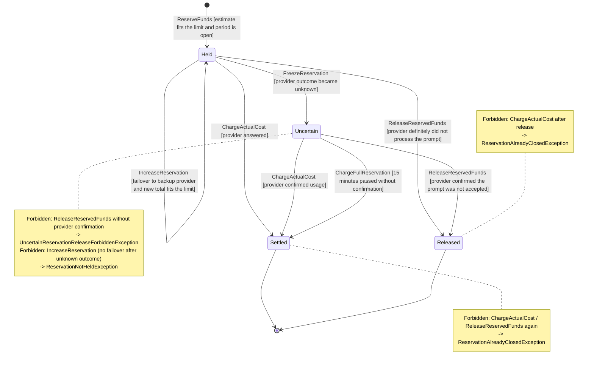

# Budget reservation – state machine, invariants and Given–When–Then

## Main aggregate: `Budget`

`Budget` is the most important aggregate of our project: it decides whether a team may spend money on an AI request. On the Event Storming board it receives the commands *Reserve funds*, *Charge actual cost*, *Release reserved funds*, *Charge full reservation* and *Record cost correction*.

Structure:

- Root: `Budget` (`BudgetId`, `TeamId`, `BudgetPeriod`, `Money limit`, `Money settledSpend`, `Money reservedAmount`)
- Internal entity: `Reservation` (`ReservationId`, `RequestId`, `CostEstimate`, `ReservationState`)
- Value Objects: `Money`, `CostEstimate`, `TokenPrice`, `BudgetPeriod`

Only **open** reservations (`Held`, `Uncertain`) live inside the aggregate. A closed reservation becomes a ledger entry (*Request cost charged*), so the collection stays small: its size is limited by how many requests of one team are running at the same moment, not by the history of the month.

All reservation changes go through the root (`budget.chargeActualCost(requestId, ...)`, never `reservation.settle(...)`), because only the root can keep `reservedAmount` and `settledSpend` correct.

## State machine of a reservation



| State | Meaning (board language) | Counts in `reservedAmount`? |
| --- | --- | --- |
| `Held` | *Funds reserved*, the provider call has not finished yet | yes |
| `Uncertain` | *Reservation frozen as uncertain*, we do not know if the provider billed us | yes – the money stays blocked |
| `Settled` | *Request cost charged* or *Full reservation charged* | no – moved to `settledSpend` |
| `Released` | *Reserved funds released*, no charge | no |

A reservation is never released just because it is old. Time only moves `Held` to `Uncertain` and, after the reconciliation deadline, `Uncertain` to `Settled` with the full amount (Hot Spot from the board: *Did the provider bill us after a timeout?*).

## Catalog of business invariants

| # | Aggregate | Business rule (invariant) | Domain exception |
| --- | --- | --- | --- |
| 1 | `Budget` | After every operation `settledSpend + reservedAmount <= limit`. A new reservation is accepted only if the estimate still fits (board: *Budget exceeded*). | `BudgetExceededException` |
| 2 | `Budget` | Funds can be reserved only while the budget period is open (`period.start <= now < period.end`). | `BudgetPeriodClosedException` |
| 3 | `Budget` | One `RequestId` has at most one reservation. Repeating *Reserve funds* with the same estimate returns the existing reservation; a different estimate for the same request is rejected. | `ReservationConflictException` |
| 4 | `Budget` | A reservation is closed exactly once: *Charge actual cost* and *Release reserved funds* are allowed only from `Held` or `Uncertain`. | `ReservationAlreadyClosedException` |
| 5 | `Budget` | An `Uncertain` reservation can be released only when the provider confirmed that the prompt was not accepted. | `UncertainReservationReleaseForbiddenException` |
| 6 | `Budget` | *Charge full reservation* is allowed only after the reconciliation deadline (15 minutes after the prompt was sent). | `ReconciliationDeadlineNotReachedException` |
| 7 | `Budget` | The team admin cannot lower the `limit` below `settledSpend + reservedAmount`. | `LimitBelowCommittedSpendException` |
| 8 | `Budget` | *Record cost correction* cannot make `settledSpend` negative. | `NegativeSettledSpendException` |

Invariant 1 is also why `Reservation` is inside `Budget` and not a separate aggregate: `reservedAmount` must always equal the sum of open reservations, and this must be true right after every commit.

## Given–When–Then scenarios (TDD)

Amounts are in USD. 1 USD = 1 000 000 micros.

### Positive 1 – funds reserved within the limit

- **Given** the budget of team `team-ai` for November 2026 has limit 10.00 USD, settled spend 0.00 USD and reserved amount 0.00 USD.
- **When** the gateway calls *Reserve funds* for request `req-1` with an estimate of 6.00 USD.
- **Then** the event *Funds reserved* is emitted, the reservation of `req-1` is `Held` with 6.00 USD, and the reserved amount is 6.00 USD.

### Positive 2 – actual cost charged, the rest goes back to the budget

- **Given** the reservation of `req-1` is `Held` with 6.00 USD, settled spend is 0.00 USD and reserved amount is 6.00 USD.
- **When** the gateway calls *Charge actual cost* for `req-1` with an actual cost of 4.50 USD.
- **Then** the event *Request cost charged* is emitted, the reservation is `Settled`, settled spend is 4.50 USD, reserved amount is 0.00 USD, and the remaining 1.50 USD is available again (not as a credit, because it was never spent).

### Negative 1 – budget exceeded by a concurrent request

- **Given** the budget has limit 10.00 USD, settled spend 0.00 USD and the reservation of `req-1` is `Held` with 6.00 USD.
- **When** the gateway calls *Reserve funds* for request `req-2` with an estimate of 6.00 USD.
- **Then** `BudgetExceededException` is thrown, no reservation exists for `req-2`, and the reserved amount stays 6.00 USD (board event: *Budget exceeded*; no prompt is sent to the provider).

### Negative 2 – uncertain reservation cannot be released

- **Given** the reservation of `req-3` is `Uncertain` with 2.00 USD after a provider timeout, and the provider has not confirmed anything.
- **When** the gateway calls *Release reserved funds* for `req-3`.
- **Then** `UncertainReservationReleaseForbiddenException` is thrown, the reservation stays `Uncertain`, and the reserved amount still contains the 2.00 USD.

### Negative 3 – charging a closed reservation twice

- **Given** the reservation of `req-1` is already `Settled` with an actual cost of 4.50 USD.
- **When** the gateway retries *Charge actual cost* for `req-1` with 4.50 USD.
- **Then** `ReservationAlreadyClosedException` is thrown and settled spend stays 4.50 USD (the team is charged only once).

## Design patterns in the `Budget` aggregate

### Factory Method – only a valid budget can be opened

The constructor is private. *Open monthly budget* is the only way to create a `Budget`, so a budget always starts with a valid period, a positive limit and zero spend.

```java
public static Budget openMonthly(TeamId teamId, BudgetPeriod period, Money limit) {
    if (limit.amountMicros() <= 0) {
        throw new InvalidBudgetLimitException(limit);
    }
    return new Budget(BudgetId.newId(), teamId, period, limit,
            Money.zero(limit.currency()), Money.zero(limit.currency()));
}
```

### Strategy (Domain Policy) – how an uncertain reservation is reconciled

Providers behave differently after a timeout. Some can be asked whether they processed a request (our mock provider), others cannot (OpenAI and Anthropic until their idempotency is verified). The board policy *Whenever reservation stays uncertain for 15 minutes, charge full reservation* is one variant of this decision. We extract it into a policy so a new provider does not require changes in `Budget`.

```java
public interface ReconciliationPolicy {
    ReconciliationDecision decide(ReservationSnapshot reservation, Instant now);
}

public sealed interface ReconciliationDecision {
    record ChargeActual(Money actualCost) implements ReconciliationDecision {}
    record Release() implements ReconciliationDecision {}
    record ChargeFull() implements ReconciliationDecision {}
    record Wait() implements ReconciliationDecision {}
}

final class StatusLookupReconciliationPolicy implements ReconciliationPolicy { /* asks the provider */ }
final class DeadlineReconciliationPolicy implements ReconciliationPolicy { /* full charge after 15 min */ }
```

```java
public void reconcile(RequestId requestId, ReconciliationPolicy policy, Instant now) {
    Reservation reservation = openReservation(requestId);
    if (reservation.state() != ReservationState.UNCERTAIN) {
        throw new ReservationNotUncertainException(requestId);
    }
    switch (policy.decide(reservation.snapshot(), now)) {
        case ReconciliationDecision.ChargeActual d -> chargeActualCost(requestId, d.actualCost());
        case ReconciliationDecision.Release d -> releaseConfirmedNotAccepted(requestId);
        case ReconciliationDecision.ChargeFull d -> chargeFullReservation(requestId, now);
        case ReconciliationDecision.Wait d -> { }
    }
}
```

The policy only **decides**. The `Budget` root still guards the invariants: it checks the state of the reservation, the reconciliation deadline (invariant 6) and the limit (invariant 1) before it changes anything.
